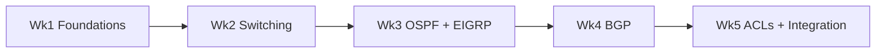
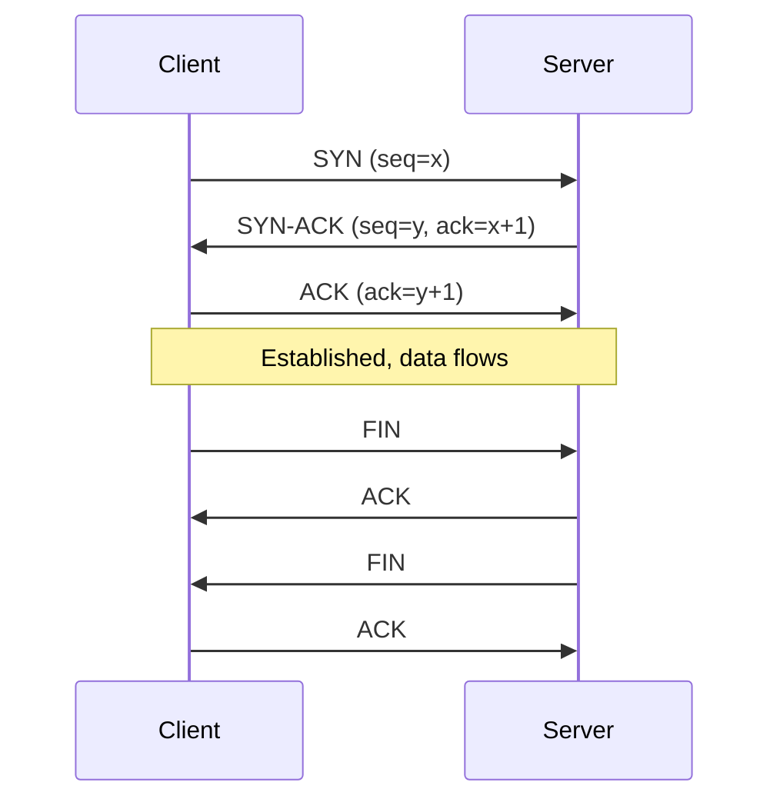
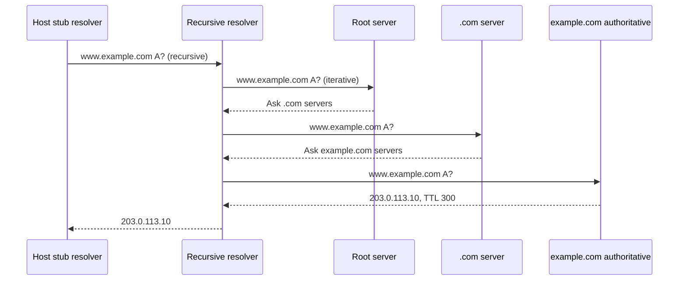
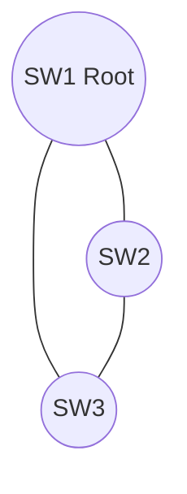
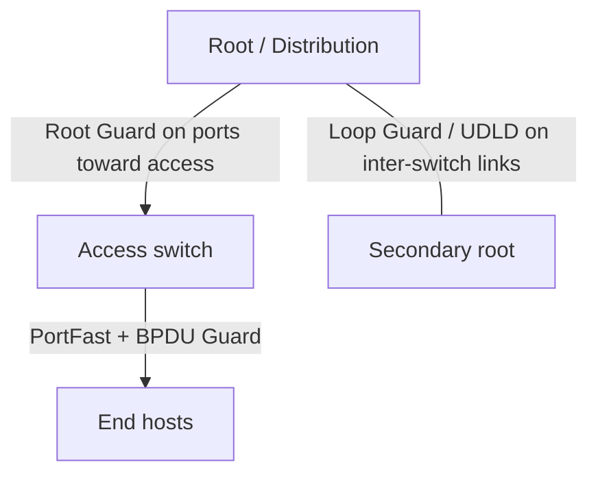
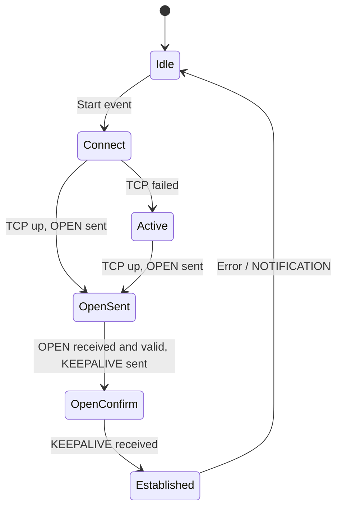
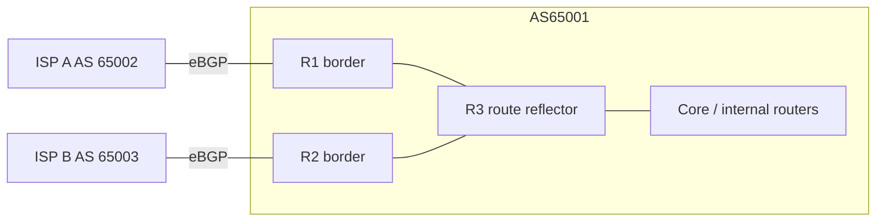

# Routing & Switching: 5-Week Self-Study Guide

A self-paced program for engineers refreshing R&S fundamentals and for new hires joining a network team.

- **Audience:** new hires, junior network engineers, anyone returning to R&S.
- **Commitment:** about 10-12 hours per week (5 study days of 1.5-2 hours including the technical write-ups, plus a 2-3 hour weekend lab).
- **Outcome:** explain and configure the core campus/enterprise stack (IP, VLAN/STP/EtherChannel, OSPF, EIGRP, BGP, ACLs) and troubleshoot it with a repeatable method.
- **Syntax:** Cisco IOS / IOS-XE. Concepts are vendor-neutral unless marked otherwise.

---

## 0. How to Use This Guide

### 0.1 Weekly rhythm

| Day | Activity |
|---|---|
| Mon-Thu | Read the day's topic, then immediately reproduce the configuration in a lab |
| Fri | Review, answer the checkpoint questions without notes |
| Weekend | Run the weekly capstone lab and write down what broke and how you fixed it |

Rule: **never read a topic without typing the commands.** Retention comes from labs and from breaking things on purpose.

### 0.1a Where the technical write-ups are

The daily notes give you the essentials and the commands. Each week ends with in-depth **Technical Write-Ups** (headings starting with `TW-`) that replace the need to open the original PDFs. Read them after the matching day.

| Write-up | Topic | Location |
|---|---|---|
| TW-1.1 | Ethernet, ARP, IP, TCP/UDP, ICMP on the wire | End of Week 1 |
| TW-1.2 | IPv4 and IPv6 addressing reference | End of Week 1 |
| TW-1.3 | NAT | End of Week 1 |
| TW-1.4 | DHCP (protocol, relay, snooping) | End of Week 1 |
| TW-1.5 | DNS | End of Week 1 |
| TW-2.1 | Layer 2 switching, port security | End of Week 2 |
| TW-2.2 | VLANs, trunking, DTP, VTP, inter-VLAN routing | End of Week 2 |
| TW-2.3 | EtherChannel (LACP/PAgP) | End of Week 2 |
| TW-2.4 | Spanning Tree (STP, RSTP, MST, protection) | End of Week 2 |
| TW-3.1 | Routing fundamentals | End of Week 3 |
| TW-3.2 | OSPF | End of Week 3 |
| TW-3.3 | EIGRP | End of Week 3 |
| TW-4.1 | BGP | End of Week 4 |
| TW-5.1 | ACLs | Week 5 |
| TW-5.2 | Redistribution and route control | Week 5 |
| TW-5.3 | Troubleshooting methodology | Week 5 |

### 0.2 Lab environment (pick one)

| Tool | Notes |
|---|---|
| Cisco Packet Tracer | Free. Good for Weeks 1-2 and ACLs. Limited for BGP detail |
| GNS3 / EVE-NG | Real IOS images. Recommended for all weeks |
| Cisco CML | Official, licensed. Best fidelity |

Recommended base topology for Weeks 2-5: 3 routers (R1-R3 in a triangle), 3 switches (SW1-SW3 in a triangle), 2-3 PCs or VPCs.

### 0.3 Study-group library map

The PDFs in this folder map to the weeks as follows.

| Topic | Source files |
|---|---|
| Network basics, IP, subnetting, IPv6 | `network-fundamentals.pdf`, `2.00 Implement IPv4.pdf`, `3.00 Implement IPv6.pdf`, `000 CCNA 200-301 - Full workbook.pdf` |
| DHCP, DNS, NAT, services | `7.00 Implement Network Services.pdf`, `Network-basic-troubleshooting.pdf` |
| Switching, VLAN, STP, EtherChannel | `switching_fundamentals.pdf`, `1.0 Implement Layer 2 Technologies.pdf`, `STP_cheatsheet.pdf`, `VTP_DTP.pdf`, `native_default_vlan.pdf`, `switchstack.pdf` |
| Routing fundamentals | `routing_fundamentals.pdf`, `Routing-training-presentation.pdf`, `redistibution.pdf` |
| OSPF | `OSPF_cheatsheet.pdf`, `OSPF_cheat_sheet2.pdf`, `OSPF_technical_writeup.pdf`, `ospf_hand_notes.pdf` |
| EIGRP | `EIGRP_cheatsheet.pdf`, `EIGRP_technical_writeup.pdf` |
| BGP | `BGP_cheatsheet.pdf`, `BGP_short_notest.pdf`, `BGP_Learning-indepth.pdf`, `BGP_AS_Path_Manipulation.pdf`, `BGP_session_reset.pdf`, `IBGP_cheatsheet.pdf`, `IBGP_config.pdf`, `BGP_routing_practice_labs.pdf`, `pynet-labs-bgp/` |
| ACLs and security | `6.00 Implement Network Security.pdf` |
| Troubleshooting | `9.00 Troubleshoot a Network.pdf`, `Network-basic-troubleshooting.pdf` |
| Exam-style Q&A | `CCNP_ENCOR_Q&A.pdf` |
| Out of scope (optional later) | MPLS, IS-IS, Palo Alto, IP Multicast, CCNP SP |

Note: `BGP_handnotes.pdf`, `ospf_hand_notes.pdf`, `Routing_switching_handwritten.pdf`, `CCIE Notes R&S.pdf` and `ccna_pynets-labs.pdf` are image-based (scanned or handwritten), so they could not be text-extracted. Open them directly as visual supplements.

### 0.4 Security conventions used in this guide

- Placeholders such as `<SECRET>` replace every password or key. Never paste real credentials into configs, tickets, or shared notes.
- Some library notes use MD5 for routing-protocol authentication. MD5 is considered weak. Prefer HMAC-SHA-256 key chains (OSPF, EIGRP) and TCP-AO where supported (BGP). The BGP `neighbor password` command (TCP MD5 option) is legacy and used only when the peer cannot do better.
- Use SSH, not Telnet, for device management. Restrict VTY with an ACL (Week 5).

---

## Program Overview

| Week | Theme | Topics |
|---|---|---|
| 1 | Network foundations | Network basics, OSI, TCP/IP, IPv4, subnetting, IPv6 intro, DNS, DHCP, ICMP tooling |
| 2 | Switching | Switch operation, VLAN, trunks, native VLAN, VTP/DTP, EtherChannel, STP/RSTP/MST |
| 3 | Routing I | Routing fundamentals, static routes, AD, OSPF, EIGRP |
| 4 | Routing II | BGP (eBGP, iBGP, attributes, path selection, policy, troubleshooting) |
| 5 | Security and integration | ACLs, redistribution, end-to-end troubleshooting, final assessment |



---

# WEEK 1: Network Foundations

**Goal:** speak the language of networking, subnet quickly and accurately, and understand what DNS and DHCP do when a host "just connects".

## Day 1: Network Basics and Components

### Key components

| Component | Layer | Role |
|---|---|---|
| Router | 3 | Forwards packets between networks using IP routing tables |
| L2 switch | 2 | Forwards frames within a LAN by MAC address |
| L3 switch | 2/3 | Switching plus inter-VLAN routing |
| Firewall / NGFW / IPS | 3-7 | Policy enforcement and threat inspection at boundaries |
| Access point (AP) | 1/2 | Bridges wireless clients to the wired LAN |
| Controller (WLC, DNA Center) | n/a | Centralised management and automation |
| Endpoints / servers | n/a | Consume and provide services |
| PoE | 1 | Power and data over one Ethernet cable (802.3af/at/bt) |

### Topology architectures

| Design | Description | Typical use |
|---|---|---|
| Two-tier (collapsed core) | Access + combined distribution/core | Small and medium sites |
| Three-tier | Access, distribution, core | Large campuses, modular growth |
| Spine-leaf | Every leaf connects to every spine | Data centres, east-west traffic |
| WAN | Point-to-point, hub-and-spoke, full/partial mesh | Site interconnect |
| SOHO | Single multifunction router/AP | Small office or home |
| On-prem / cloud / hybrid | Own DC versus provider versus both | Workload placement |

### Physical media

| Media | Distance | Notes |
|---|---|---|
| Copper (UTP Cat5e/6) | up to 100 m | Cheapest, EMI-prone |
| Multimode fibre (50/62.5 um) | up to about 2 km (speed dependent) | LED/VCSEL, intra-building and DC |
| Single-mode fibre (8-10 um) | tens of km | Laser, campus and WAN |

### Interface health: what to look for

```
show interfaces GigabitEthernet0/1
```

- **CRC / input errors:** bad cable, bad transceiver, or duplex mismatch.
- **Late collisions:** almost always a duplex mismatch.
- **Speed/duplex:** set both ends to auto, or hard-code both ends identically. Never one of each.

Checkpoint: why do late collisions on a full-duplex link point to a mismatch rather than a busy network?

## Day 2: OSI and TCP/IP Models

| OSI layer | PDU | Examples | TCP/IP layer |
|---|---|---|---|
| 7 Application | Data | HTTP, DNS, DHCP, SSH | Application |
| 6 Presentation | Data | TLS, encoding | Application |
| 5 Session | Data | Session setup | Application |
| 4 Transport | Segment / datagram | TCP, UDP | Transport |
| 3 Network | Packet | IP, ICMP, OSPF | Internet |
| 2 Data link | Frame | Ethernet, 802.1Q, ARP | Network access |
| 1 Physical | Bits | Cables, radio | Network access |

Mnemonic (7 to 1): **A**ll **P**eople **S**eem **T**o **N**eed **D**ata **P**rocessing.

### Encapsulation

Data -> segment (add L4 header: ports) -> packet (add L3 header: IPs) -> frame (add L2 header and trailer: MACs, FCS) -> bits.

### TCP versus UDP

| | TCP | UDP |
|---|---|---|
| Connection | Connection-oriented (3-way handshake: SYN, SYN-ACK, ACK) | Connectionless |
| Reliability | Acknowledgements, retransmit, ordering, flow control | None |
| Overhead | Higher | Minimal |
| Examples | HTTP/S, SSH, FTP, SMTP, BGP (179) | DNS (53), DHCP (67/68), TFTP, VoIP, syslog |

### Frequently seen ports

| Port | Service | Port | Service |
|---|---|---|---|
| 20/21 | FTP | 80 / 443 | HTTP / HTTPS |
| 22 | SSH | 67 / 68 | DHCP server / client |
| 23 | Telnet (avoid) | 123 | NTP |
| 25 | SMTP | 161 / 162 | SNMP |
| 53 | DNS | 179 | BGP |

Routing protocols carried directly over IP: OSPF (protocol 89), EIGRP (protocol 88).

### ARP and ICMP

- **ARP** resolves an IPv4 address to a MAC on the local segment. Check with `show ip arp` (router) or `arp -a` (host).
- **ICMP** carries diagnostics: echo (ping), TTL exceeded (traceroute), destination unreachable.

### Walk-through: what happens when PC-A pings PC-B on another subnet

1. PC-A sees PC-B is off-subnet, so it ARPs for its **default gateway** MAC.
2. PC-A sends a frame: destination MAC = gateway, destination IP = PC-B.
3. Router de-encapsulates, does a routing-table lookup, decrements TTL, ARPs for PC-B (or next hop), and re-encapsulates with new L2 addresses.
4. L3 addresses stay end to end. L2 addresses change at every hop.

## Day 3: IPv4 Addressing and Subnetting

### Address classes and special ranges

| Range | Notes |
|---|---|
| 10.0.0.0/8, 172.16.0.0/12, 192.168.0.0/16 | RFC 1918 private (needs NAT to reach the Internet) |
| 127.0.0.0/8 | Loopback |
| 169.254.0.0/16 | APIPA link-local (DHCP failed) |
| 224.0.0.0/4 | Multicast |

### Subnetting method (works for any prefix)

1. Find the **interesting octet** (where the mask is not 255 or 0).
2. **Block size** = 256 - mask value in that octet.
3. Network = largest multiple of block size <= the address.
4. Broadcast = next network - 1. Usable hosts = network + 1 through broadcast - 1.
5. Hosts per subnet = 2^(host bits) - 2.

| Prefix | Mask | Block size | Hosts |
|---|---|---|---|
| /24 | 255.255.255.0 | n/a | 254 |
| /25 | 255.255.255.128 | 128 | 126 |
| /26 | 255.255.255.192 | 64 | 62 |
| /27 | 255.255.255.224 | 32 | 30 |
| /28 | 255.255.255.240 | 16 | 14 |
| /29 | 255.255.255.248 | 8 | 6 |
| /30 | 255.255.255.252 | 4 | 2 |
| /31 | 255.255.255.254 | 2 | 2 (point-to-point, RFC 3021) |

### Worked example 1: which subnet is 192.168.10.77/26 in?

Block size 64. Multiples: 0, 64, 128, 192. Network = 192.168.10.64, broadcast = 192.168.10.127, usable = .65 to .126.

### Worked example 2: split 192.168.10.0/24 into 4 equal subnets

Borrow 2 bits to get /26: `.0/26`, `.64/26`, `.128/26`, `.192/26` with 62 hosts each.

### Worked example 3: VLSM

Requirement from 10.1.0.0/24: LAN-A 100 hosts, LAN-B 50 hosts, LAN-C 20 hosts, two point-to-point links.

Allocate largest first:

| Need | Prefix | Subnet |
|---|---|---|
| LAN-A (100) | /25 | 10.1.0.0/25 |
| LAN-B (50) | /26 | 10.1.0.128/26 |
| LAN-C (20) | /27 | 10.1.0.192/27 |
| Link 1 | /30 | 10.1.0.224/30 |
| Link 2 | /30 | 10.1.0.228/30 |

### Wildcard masks (needed for OSPF, EIGRP, ACLs)

Wildcard = 255.255.255.255 - subnet mask. A /26 mask 255.255.255.192 has wildcard 0.0.0.63.

### Summarisation

To summarise 10.1.0.0/24 through 10.1.3.0/24: the third octet 0-3 spans 4 values, so 2 bits, giving **10.1.0.0/22**.

### Configure and verify

```
interface GigabitEthernet0/0
 ip address 192.168.1.1 255.255.255.0
 no shutdown
!
show ip interface brief
show running-config interface GigabitEthernet0/0
ping 192.168.1.2
```

### Client-side verification

| OS | Command |
|---|---|
| Windows | `ipconfig /all` |
| macOS | `ifconfig`, `ipconfig getifaddr en0` |
| Linux | `ip a`, `ip route` |

## Day 4: IPv6 Essentials

- 128-bit, written as 8 groups of hex. Leading zeros may be dropped and one run of zero groups may become `::`.
- No broadcast. No ARP (uses Neighbor Discovery over ICMPv6).

| Type | Prefix | Notes |
|---|---|---|
| Global unicast | 2000::/3 | Internet-routable |
| Unique local | fc00::/7 (fd00::/8 in use) | Private, like RFC 1918 |
| Link-local | fe80::/10 | Auto on every IPv6 interface, never routed |
| Multicast | ff00::/8 | ff02::1 all nodes, ff02::2 all routers |
| Anycast | from unicast space | Same address on several nodes, nearest wins |

**Modified EUI-64:** split the 48-bit MAC, insert `FFFE` in the middle, flip the 7th bit (U/L). Example: MAC `00:1A:2B:3C:4D:5E` gives interface ID `021A:2BFF:FE3C:4D5E`.

(The source slide shows `001A:2BFF:...` without the bit flip. The flip changes the first byte from `00` to `02`.)

```
ipv6 unicast-routing
interface GigabitEthernet0/0
 ipv6 address 2001:db8:1:1::1/64
 ipv6 address fe80::1 link-local
 no shutdown
!
show ipv6 interface brief
ping 2001:db8:1:2::1
```

## Day 5: DNS, DHCP, NAT

### DHCP (UDP 67 server, 68 client)

**DORA** process:

1. **D**iscover: client broadcasts.
2. **O**ffer: server proposes an address.
3. **R**equest: client accepts one offer (broadcast, so other servers learn).
4. **A**cknowledge: server confirms the lease.

A DHCP message delivers address, mask, default gateway, DNS servers, and lease time.

If the server is on another subnet, the gateway must **relay** the broadcast as unicast:

```
interface GigabitEthernet0/1
 ip helper-address 10.0.0.10
```

IOS as DHCP server:

```
service dhcp
ip dhcp excluded-address 192.168.10.1 192.168.10.20
ip dhcp pool LAN10
 network 192.168.10.0 255.255.255.0
 default-router 192.168.10.1
 dns-server 10.0.0.53
 lease 1
!
show ip dhcp binding
show ip dhcp server statistics
```

Troubleshooting: host shows 169.254.x.x means no offer received. Check VLAN membership, relay address, helper on the right SVI, and server scope exhaustion.

### DNS (UDP/TCP 53)

Resolves names to addresses.

| Record | Purpose |
|---|---|
| A / AAAA | Name to IPv4 / IPv6 |
| CNAME | Alias |
| MX | Mail exchanger |
| PTR | Reverse lookup (IP to name) |
| NS | Authoritative name server |
| TXT | Free text (SPF, verification) |

Resolution path: stub resolver -> local cache -> recursive resolver -> root -> TLD -> authoritative server. Test with `nslookup`, `dig example.com`, and `ip domain-lookup` / `ip name-server` on IOS.

### NAT (awareness)

Translates private to public addresses. Static NAT (1:1), dynamic NAT (pool), PAT/overload (many:1 using ports).

## Week 1 Technical Write-Ups

These write-ups go deeper than the daily notes. Read them after the matching day and use them as the reference when a lab behaves unexpectedly.

### TW-1.1 Ethernet, ARP, IP, TCP/UDP, ICMP: what is actually on the wire

#### Ethernet II frame

| Field | Size | Notes |
|---|---|---|
| Preamble + SFD | 8 bytes | Synchronisation, not counted in frame size |
| Destination MAC | 6 bytes | Unicast, multicast (low bit of first byte = 1), or broadcast `ffff.ffff.ffff` |
| Source MAC | 6 bytes | Always unicast |
| EtherType | 2 bytes | `0x0800` IPv4, `0x0806` ARP, `0x86DD` IPv6, `0x8100` 802.1Q tag |
| Payload | 46-1500 bytes | Padded to 46 if shorter. 1500 is the standard MTU |
| FCS | 4 bytes | CRC-32. Failure increments the CRC counter and the frame is dropped |

- Minimum frame 64 bytes, maximum 1518 (1522 with one 802.1Q tag). Larger "jumbo" frames need `system mtu jumbo` on every device in the path.
- A MAC address is 48 bits: 24-bit OUI (vendor) + 24-bit device ID. Bit 0 of the first byte = group (multicast) bit; bit 1 = locally administered bit.
- IPv4 multicast maps to MAC `01:00:5e` + the low 23 bits of the group address. IPv6 multicast maps to `33:33` + the low 32 bits.
- **Collision domain** = one port on a switch (full duplex has none). **Broadcast domain** = one VLAN or one routed interface.

#### Ethernet speeds and media

| Standard | Speed | Medium | Reach |
|---|---|---|---|
| 100BASE-TX | 100 Mbps | Cat5 UTP | 100 m |
| 1000BASE-T | 1 Gbps | Cat5e UTP | 100 m |
| 1000BASE-SX / LX | 1 Gbps | MMF / SMF | 550 m / 5-10 km |
| 10GBASE-T | 10 Gbps | Cat6a | 100 m |
| 10GBASE-SR / LR | 10 Gbps | MMF / SMF | 300-400 m / 10 km |

Auto-negotiation exchanges speed and duplex using link pulses. If one side is hard-coded and the other is on auto, the auto side detects speed but falls back to **half duplex**, producing a duplex mismatch (late collisions on the half-duplex side, CRC/runts on the full-duplex side). Gigabit and above require auto-negotiation. PoE: 802.3af = 15.4 W, 802.3at = 30 W, 802.3bt = 60/90 W per port.

#### ARP

1. Host needs the MAC for an IP on its own subnet (or for its default gateway).
2. It broadcasts "Who has 10.1.1.1? Tell 10.1.1.50" (EtherType `0x0806`).
3. The owner replies unicast with its MAC. Both sides cache the result (4 hours on IOS by default).

Variants: **gratuitous ARP** (host announces its own IP, used for duplicate detection and failover), **proxy ARP** (a router answers on behalf of remote hosts, enabled by default on IOS and best disabled with `no ip proxy-arp`). `show ip arp` and `arp -a` display the cache. ARP has no authentication, hence spoofing attacks; Dynamic ARP Inspection (TW-1.4) mitigates this.

#### IPv4 header (20 bytes minimum)

| Field | Purpose |
|---|---|
| Version / IHL | 4 / header length in 32-bit words |
| DSCP / ECN | QoS marking and congestion notification |
| Total length | Header + data, up to 65535 |
| Identification, Flags (DF, MF), Fragment offset | Fragmentation and reassembly |
| TTL | Decremented at each router. At 0 the router discards and sends ICMP Time Exceeded |
| Protocol | 1 ICMP, 6 TCP, 17 UDP, 47 GRE, 50 ESP, 88 EIGRP, 89 OSPF |
| Header checksum | Recomputed at each hop because TTL changes |
| Source / Destination | 32-bit addresses |

**MTU, fragmentation, and MSS.** If a packet is larger than the egress MTU and DF=0, the router fragments it. If DF=1, the router drops it and returns ICMP type 3 code 4 ("fragmentation needed") so the sender lowers its size. This is **Path MTU Discovery (PMTUD)**. Tunnels (GRE, IPsec) reduce usable MTU, and filtering ICMP breaks PMTUD, which shows up as "ping works, large transfers hang". TCP advertises a **MSS** in the SYN (typically 1460 for a 1500 MTU). `ip tcp adjust-mss 1360` on a tunnel interface is the common fix.

#### TCP in detail

Header fields: source/destination port, 32-bit sequence number, 32-bit acknowledgement number, flags (SYN, ACK, FIN, RST, PSH, URG), window size, checksum.



- **Reliability:** every byte is numbered. The receiver acknowledges cumulatively; the sender retransmits on timeout or after three duplicate ACKs.
- **Flow control:** the receiver's window field says how much more data it can buffer.
- **Congestion control:** the sender grows its window exponentially (slow start) then linearly (congestion avoidance) and halves it on loss.
- **RST** aborts a connection immediately. A firewall or ACL that silently drops packets produces timeouts; a closed port produces RST (fast "connection refused").
- Port ranges: 0-1023 well-known, 1024-49151 registered, 49152-65535 ephemeral (client side).

**UDP** has an 8-byte header (source port, destination port, length, checksum) and no handshake, ordering, or retransmission. Applications that need reliability must provide it themselves. Used when latency matters more than completeness or when a single request/response is enough (DNS, DHCP, NTP, syslog, SNMP, RTP).

#### ICMP

| Type / code | Meaning | Seen in |
|---|---|---|
| 0 / 0 | Echo reply | ping |
| 8 / 0 | Echo request | ping |
| 3 / 0, 1, 3, 4 | Net, host, port unreachable; fragmentation needed | Routing failures, closed UDP ports, PMTUD |
| 5 | Redirect | Better gateway exists on the same segment |
| 11 / 0 | TTL exceeded in transit | traceroute |

**Traceroute** sends probes with TTL 1, 2, 3, ... Each router that decrements TTL to zero returns Time Exceeded, revealing the hop. The final host returns port-unreachable (UDP probes) or echo reply (ICMP probes). Stars (`*`) mean a hop does not answer probes, not necessarily a failure.

#### Layered troubleshooting map

| Symptom | Layer | First check |
|---|---|---|
| Link light off, errors | 1 | Cable, SFP, speed/duplex |
| No ARP reply | 2 | VLAN, trunk, port security, STP |
| Ping gateway fails | 2/3 | IP/mask, VLAN |
| Ping remote fails, gateway OK | 3 | Routing, return route, ACL |
| Ping OK, application fails | 4-7 | Port filtering, DNS, MTU, application |

### TW-1.2 IPv4 and IPv6 addressing: technical reference

#### Binary and masks

An IPv4 address is 32 bits. A prefix length `/n` means the first `n` bits identify the network.

| Binary octet | Decimal | Binary octet | Decimal |
|---|---|---|---|
| 10000000 | 128 | 11111000 | 248 |
| 11000000 | 192 | 11111100 | 252 |
| 11100000 | 224 | 11111110 | 254 |
| 11110000 | 240 | 11111111 | 255 |

Bit weights per octet: 128, 64, 32, 16, 8, 4, 2, 1.

#### Classes (historical) versus CIDR

| Class | First octet | Default mask | Note |
|---|---|---|---|
| A | 1-126 | /8 | |
| B | 128-191 | /16 | |
| C | 192-223 | /24 | |
| D | 224-239 | n/a | Multicast |
| E | 240-255 | n/a | Reserved |

Modern networks are **classless (CIDR)**: any prefix length is valid, and routing protocols carry the mask. Classes matter only for legacy defaults (classful auto-summary in old EIGRP/RIP).

#### Special-purpose addresses

| Address | Use |
|---|---|
| 0.0.0.0/0 | Default route / "any" |
| 127.0.0.0/8 | Loopback |
| 169.254.0.0/16 | Link-local (APIPA) |
| 100.64.0.0/10 | Carrier-grade NAT (shared address space) |
| 192.0.2.0/24, 198.51.100.0/24, 203.0.113.0/24 | Documentation |
| 255.255.255.255 | Limited broadcast |

#### Subnet design procedure

1. List every segment and its required host count (add 20-30% growth).
2. Compute the prefix for each: smallest `n` where 2^(32-n) - 2 >= hosts.
3. Sort descending and allocate **largest first**, aligned on block boundaries (VLSM).
4. Assign /30 or /31 for point-to-point links, /32 for loopbacks.
5. Leave contiguous space so that each site or region can be summarised.
6. Record the plan (IPAM or spreadsheet) before configuring anything.

#### Summarisation (supernetting) rule

A set of networks can be summarised into one prefix only if they are contiguous, the count is a power of two, and the first network falls on the block boundary.

Example: 172.16.4.0/24 through 172.16.7.0/24 -> four /24s = 2 bits -> `172.16.4.0/22` (4 is divisible by 4, so it fits). 172.16.3.0/24 through 172.16.6.0/24 does **not** align and needs two summaries.

#### Wildcard masks

Bit 0 = must match, bit 1 = ignore. Used by OSPF/EIGRP `network` statements and ACLs.

| Intent | Address | Wildcard |
|---|---|---|
| Whole /27 | 10.1.1.32 | 0.0.0.31 |
| Range 192.168.0.0 to 192.168.3.255 | 192.168.0.0 | 0.0.3.255 |
| Odd addresses only in the last octet | 10.1.1.1 | 0.0.0.254 |

#### IPv6 in more detail

- **Structure:** 64-bit network prefix (global routing prefix + subnet ID) and 64-bit interface ID. Subnets are almost always /64 (SLAAC requires it). Sites typically receive /48 or /56.
- **Documentation prefix:** `2001:db8::/32`.
- **No broadcast.** Multicast replaces it: `ff02::1` all nodes, `ff02::2` all routers, `ff02::5` OSPFv3, `ff02::a` EIGRP, `ff02::1:ffXX:XXXX` solicited-node.
- **Neighbor Discovery (ICMPv6)** replaces ARP:

| Message | Type | Purpose |
|---|---|---|
| Router Solicitation (RS) | 133 | Host asks for router info |
| Router Advertisement (RA) | 134 | Router announces prefix, gateway, flags |
| Neighbor Solicitation (NS) | 135 | Resolve address (ARP equivalent) and DAD |
| Neighbor Advertisement (NA) | 136 | Reply |

- **Address assignment:** manual, **SLAAC** (host builds address from RA prefix + EUI-64 or random ID), or **DHCPv6** (stateful, or stateless for DNS only). RA flags decide: A (autonomous), M (managed), O (other config).
- **Duplicate Address Detection (DAD)** sends an NS for the tentative address before using it.
- **Default gateway:** the router's link-local address (learned from RA), so link-local addresses must be stable on routers.
- **Coexistence:** dual stack (preferred), tunnelling (6in4, GRE), translation (NAT64/DNS64).
- Essential commands: `show ipv6 interface brief`, `show ipv6 neighbors`, `show ipv6 route`, `ping ipv6 <addr>`.

### TW-1.3 NAT technical write-up

NAT rewrites IP headers so that private hosts can use a limited pool of public addresses.

| Term | Meaning |
|---|---|
| Inside local | Private address of an inside host |
| Inside global | Public address representing that host |
| Outside global | Real address of the external host |
| Outside local | Address of the external host as seen inside (usually same as outside global) |

| Type | Mapping | Use |
|---|---|---|
| Static NAT | 1:1 fixed | Publish a server |
| Dynamic NAT | Pool, 1:1 on demand | Rare today |
| **PAT / overload** | Many:1 using unique source ports | Internet access for LANs |

```
interface GigabitEthernet0/0
 ip nat inside
interface GigabitEthernet0/1
 ip nat outside
ip access-list standard NAT-INSIDE
 permit 10.0.0.0 0.255.255.255
ip nat inside source list NAT-INSIDE interface GigabitEthernet0/1 overload
ip nat inside source static tcp 10.1.1.10 443 203.0.113.10 443
!
show ip nat translations
show ip nat statistics
```

Pitfalls: wrong `inside`/`outside` roles, ACL that does not match the traffic, protocols that embed IP addresses in payload (need ALG), and NAT breaking end-to-end visibility in logs. NAT is not a security control; use a firewall or ACLs for that.

### TW-1.4 DHCP technical write-up

#### Protocol

DHCP is built on BOOTP and uses UDP 67 (server) and 68 (client). The same fixed header carries `op`, `xid` (transaction ID), `ciaddr`, `yiaddr` (address offered), `siaddr`, `giaddr` (relay), `chaddr` (client MAC), followed by options.

| Message (option 53) | Direction | Notes |
|---|---|---|
| DISCOVER | client -> broadcast | Source 0.0.0.0, destination 255.255.255.255 |
| OFFER | server -> client | Contains proposed `yiaddr` and lease |
| REQUEST | client -> broadcast | Selects one server and implicitly declines the rest. Also used to renew |
| ACK | server -> client | Lease confirmed |
| NAK | server -> client | Request refused (wrong subnet, lease gone). Client restarts |
| DECLINE | client -> server | Client detected the address already in use (ARP probe) |
| RELEASE | client -> server | Client gives the lease back |
| INFORM | client -> server | Client has a static address and only wants options |

Common options: 1 subnet mask, 3 default gateway, 6 DNS servers, 15 domain name, 51 lease time, 58 renewal time T1 (default 50% of lease), 59 rebinding time T2 (87.5%), 66/150 TFTP server (phones, boot), 82 relay agent information.

#### Lease lifecycle

1. **Bound.** At T1 the client unicasts a REQUEST to the original server to renew.
2. If no answer by T2, the client broadcasts a REQUEST to any server (rebind).
3. If the lease expires, the client drops the address and restarts with DISCOVER.

#### Relay

A router receiving a client broadcast on an interface with `ip helper-address` converts it to a unicast toward the server and writes its own interface address into `giaddr`. The server uses `giaddr` to select the right pool and replies to the relay, which forwards to the client. `ip helper-address` also forwards other UDP broadcasts (TFTP 69, DNS 53, NTP 123, NetBIOS 137/138, TACACS 49) unless limited with `no ip forward-protocol udp <port>`.

#### Server on IOS

```
service dhcp
ip dhcp excluded-address 10.10.20.1 10.10.20.20
ip dhcp pool USERS
 network 10.10.20.0 255.255.255.0
 default-router 10.10.20.1
 dns-server 10.10.0.53
 domain-name corp.example
 lease 7
!
show ip dhcp binding
show ip dhcp pool
show ip dhcp conflict
show ip dhcp server statistics
debug ip dhcp server packet
```

#### Securing DHCP at Layer 2

Without protection, any host can run a rogue DHCP server or exhaust the pool.

```
ip dhcp snooping
ip dhcp snooping vlan 10,20
interface GigabitEthernet0/48          ! uplink toward the legitimate server
 ip dhcp snooping trust
interface range GigabitEthernet0/1 - 24
 ip dhcp snooping limit rate 15         ! packets per second, errdisable if exceeded
!
show ip dhcp snooping
show ip dhcp snooping binding
```

- **Untrusted** ports may send only client messages (DISCOVER, REQUEST). Server messages (OFFER, ACK) are dropped.
- The **snooping binding table** (MAC, IP, VLAN, port, lease) feeds **Dynamic ARP Inspection** (`ip arp inspection vlan 10`) and **IP Source Guard** (`ip verify source`).
- Option 82 insertion by the switch may confuse a server or relay; `no ip dhcp snooping information option` on the switch when the relay is a router that rejects it.

#### Troubleshooting checklist

| Observation | Likely cause |
|---|---|
| Client gets 169.254.x.x | No OFFER: wrong VLAN, relay missing, server down, snooping dropping, scope exhausted |
| Client gets wrong subnet | Rogue DHCP server, wrong `giaddr` pool match |
| Address works, DNS fails | Option 6 missing or incorrect |
| Duplicate IP warnings | Static address inside the pool; add `excluded-address` |
| Works on VLAN A, not B | `helper-address` missing on VLAN B's SVI |

### TW-1.5 DNS technical write-up

#### Architecture

DNS is a distributed, hierarchical database: root (`.`) -> top-level domains (`.com`, `.org`) -> second-level (`example.com`) -> hosts. Each zone is served by **authoritative** servers (primary and secondaries). **Recursive resolvers** (ISP, enterprise, public) do the lookups on behalf of clients and cache the answers.



- The host first checks its own cache and hosts file, then asks its configured resolver.
- **TTL** controls how long any cache may keep an answer. Lower TTL before a planned change.
- **Negative caching** stores NXDOMAIN answers too.

#### Message format and transport

Header: 16-bit ID, flags (QR query/response, Opcode, AA authoritative answer, TC truncated, RD recursion desired, RA recursion available, RCODE), counts for question/answer/authority/additional sections.

| RCODE | Meaning |
|---|---|
| 0 NOERROR | Success (may still have zero answers) |
| 2 SERVFAIL | Server could not answer (DNSSEC failure, upstream down) |
| 3 NXDOMAIN | Name does not exist |
| 5 REFUSED | Policy denied the query |

Transport: UDP 53 for most queries (classic limit 512 bytes, larger with EDNS0). **TCP 53** is used when a reply is truncated and for zone transfers (AXFR/IXFR). Firewalls must permit both. Encrypted variants: DNS over TLS (853) and DNS over HTTPS (443).

#### Record types

| Type | Content | Example use |
|---|---|---|
| SOA | Zone metadata (serial, refresh, retry, expire, negative TTL) | Every zone |
| NS | Name servers of a zone | Delegation |
| A / AAAA | IPv4 / IPv6 address | Web server |
| CNAME | Alias to another name (cannot coexist with other records on the same name) | `www` -> `web` |
| MX | Mail exchanger with priority | Email |
| PTR | Address to name (in `in-addr.arpa` / `ip6.arpa`) | Reverse lookup, logging |
| TXT | Text | SPF, DKIM, domain verification |
| SRV | Service location (host, port, priority) | SIP, LDAP, AD |

#### Enterprise designs

- Internal resolvers forward unknown names to upstream resolvers (forwarders).
- **Split-horizon DNS:** the same name returns an internal address inside and a public address outside.
- Redundancy: at least two resolvers in DHCP, ideally in different locations. Anycast resolvers are common for scale.
- Active Directory depends on DNS SRV records; never point domain-joined clients directly to public DNS.

#### Security considerations

| Threat | Description | Mitigation |
|---|---|---|
| Cache poisoning | Forged answers enter a resolver cache | Random source ports and IDs, DNSSEC validation |
| Amplification / reflection DDoS | Spoofed queries produce large replies | Disable open recursion, rate limiting, BCP 38 filtering |
| Tunnelling / exfiltration | Data hidden in query names | DNS logging and analytics, restrict egress to approved resolvers |
| Zone transfer leakage | AXFR to anyone | Restrict transfers to named secondaries (ACL, TSIG) |

**DNSSEC** adds signatures (RRSIG, DNSKEY, DS records) so that a validating resolver can prove an answer is authentic. It provides integrity, not confidentiality.

#### Tools and IOS commands

```
dig example.com A
dig +trace example.com
dig @10.10.0.53 example.com MX
dig -x 203.0.113.10
nslookup example.com 8.8.8.8
!
ip domain name corp.example
ip name-server 10.10.0.53 10.10.0.54
ip domain lookup
ip host LAB-R2 2.2.2.2
no ip domain lookup          ! stops the router hanging on typos in the CLI
```

| Symptom | Check |
|---|---|
| Can ping by IP, not by name | Resolver address, DNS reachability (UDP/TCP 53), search domain |
| One name fails, others fine | Stale cache or TTL, NXDOMAIN versus SERVFAIL, record missing |
| Slow browsing | First resolver down: clients wait for timeout before trying the second |
| Wrong answer from some clients | Split-horizon or different resolver, local `hosts` entry |

### Week 1 checkpoint questions

1. What changes and what stays the same in a packet crossing three routers?
2. Subnet 172.16.50.200/27: give network, broadcast, and host range.
3. Why does DHCP Discover work across a router only with a relay agent?
4. Compress `2001:0db8:0000:0000:0000:ff00:0042:8329`.
5. A host has 169.254.12.5. What happened and where do you look first?

### Week 1 weekend lab

Build 3 routers in a triangle with /30 links plus a LAN behind R1 using DHCP. Verify host gets address, gateway, DNS. Capture DORA and a DNS query in Wireshark.

---

# WEEK 2: Switching

**Goal:** design and troubleshoot a loop-free, segmented Layer 2 network.

## Day 1: Switch Operation and Layer 2 Services

### Core behaviours

| Behaviour | Meaning |
|---|---|
| Learn | Source MAC of every frame is recorded against ingress port and VLAN |
| Forward | Known unicast goes out one port |
| Flood | Unknown unicast, broadcast, and most multicast go out every port in the VLAN except ingress |
| Age | Entries expire after 300 seconds by default |

```
show mac address-table
show mac address-table aging-time
clear mac address-table dynamic
mac address-table static 0000.aaaa.bbbb vlan 10 interface Gi0/1
```

### Housekeeping protocols

| Protocol | Purpose | Commands |
|---|---|---|
| CDP (Cisco) / LLDP (open) | Neighbour discovery | `show cdp neighbors detail`, `show lldp neighbors` |
| UDLD | Detect one-way fibre/copper links | `udld enable` / `udld aggressive`, `show udld neighbors` |
| Errdisable | Auto-shutdown of misbehaving ports | `show errdisable recovery`, `errdisable recovery cause bpduguard` |
| MTU | Max frame size | `show system mtu`, `system mtu jumbo 9000` |

Security note: disable CDP/LLDP on edge ports facing users or the Internet to avoid leaking device and version details.

## Day 2: VLANs and Trunking

A VLAN is a separate broadcast domain. Typically one VLAN maps to one IP subnet.

### Access port

```
vlan 10
 name SALES
interface GigabitEthernet0/1
 switchport mode access
 switchport access vlan 10
```

### Trunk (802.1Q)

802.1Q inserts a 4-byte tag (12-bit VLAN ID, so 1-4094; 3-bit priority). Only the **native VLAN** is sent untagged.

```
interface GigabitEthernet0/2
 switchport trunk encapsulation dot1q   ! only on platforms that also support ISL
 switchport mode trunk
 switchport trunk native vlan 99
 switchport trunk allowed vlan 10,20,30
 switchport nonegotiate
!
show interfaces trunk
show interfaces Gi0/2 switchport
show vlan brief
```

| Term | Meaning |
|---|---|
| Normal-range VLAN | 1-1005 |
| Extended-range VLAN | 1006-4094 |
| Native VLAN | Untagged VLAN on a trunk. Must match on both ends |
| Default VLAN | VLAN 1, where ports sit until assigned (see `native_default_vlan.pdf`) |
| Voice VLAN | `switchport voice vlan 20` for IP phones, tagged separately from data |

Best practice: change native VLAN to an unused VLAN, prune unneeded VLANs from trunks, disable unused ports and place them in an unused VLAN, and never use VLAN 1 for user traffic.

### Inter-VLAN routing

| Method | Notes |
|---|---|
| Router-on-a-stick | Sub-interfaces with `encapsulation dot1Q <id>` on one trunk |
| SVI on L3 switch | `interface vlan 10` with `ip address`; most common |
| Routed port | `no switchport` |

```
ip routing
interface vlan 10
 ip address 10.10.10.1 255.255.255.0
```

### VTP and DTP

- **DTP** negotiates trunking automatically. Modes: access, trunk, dynamic auto, dynamic desirable. Best practice: hard-set modes and use `switchport nonegotiate`.
- **VTP** propagates VLAN database over trunks (server, client, transparent; v1/v2/v3). Dangerous: a switch with a higher revision number can overwrite the VLAN database of the whole domain. Prefer **transparent** or **off**, or use VTPv3 with a primary server.

## Day 3: EtherChannel (Port-Channel)

Bundles up to 8 active physical links into one logical link: more bandwidth, redundancy, and STP sees one link.

| Protocol | Modes | Standard |
|---|---|---|
| LACP | active, passive | IEEE 802.3ad / 802.1AX |
| PAgP | desirable, auto | Cisco |
| Static | on | none |

Valid formations: active-active, active-passive, desirable-desirable, desirable-auto. `on` forms only with `on`. passive-passive and auto-auto never form.

### Configure (Layer 2, LACP)

```
interface range GigabitEthernet0/1 - 2
 channel-group 1 mode active
interface Port-channel1
 switchport mode trunk
 switchport trunk allowed vlan 10,20,30
!
show etherchannel summary
show etherchannel port-channel
show lacp neighbor
```

Flags in `show etherchannel summary`: `SU` = Layer 2 in use (healthy); `SD` = down; `P` = bundled; `I` = standalone; `s` = suspended.

### Layer 3 EtherChannel

```
interface Port-channel2
 no switchport
 ip address 192.168.1.1 255.255.255.0
```

### Load balancing

Per-flow hash, not per-packet: `port-channel load-balance src-dst-ip` (also src-mac, dst-mac, src-dst-mac, src-dst-port). A single flow never exceeds one member link's speed.

### Consistency rules (members must match)

Speed, duplex, VLAN/trunk settings, native VLAN, allowed VLANs, and STP settings. A mismatch leaves a member suspended.

Guard: `spanning-tree etherchannel guard misconfig`.

Multichassis EtherChannel (VSS, vPC, StackWise) lets members terminate on two physical chassis with no STP-blocked links.

## Day 4: Spanning Tree Protocol (Part 1)

Redundant Layer 2 paths cause broadcast storms and MAC table instability because Ethernet frames have no TTL. STP creates a loop-free tree.

### Election and roles

1. **Root bridge:** lowest Bridge ID = priority (default 32768 + VLAN ID) + MAC.
2. **Root port (RP):** on each non-root switch, the single best path to root (lowest root path cost, then lowest sender BID, then sender port ID).
3. **Designated port (DP):** one per segment, the port with best path toward root.
4. Everything else is **blocked** (alternate).

### Path cost (802.1D short method)

| Speed | Cost |
|---|---|
| 10 Mbps | 100 |
| 100 Mbps | 19 |
| 1 Gbps | 4 |
| 10 Gbps | 2 |

(Rapid-PVST+/MST use a long method by default: 1G = 20000, 10G = 2000.)

### Timers (set on the root; propagate to all)

Hello 2 s, forward delay 15 s, max age 20 s. Classic STP convergence: about 30 s (listening + learning) or 50 s (with max age).

### Port states (802.1D)

Blocking -> Listening -> Learning -> Forwarding (Disabled is administrative).

### Configure root placement

```
spanning-tree mode rapid-pvst
spanning-tree vlan 10,20 root primary
spanning-tree vlan 10,20 root secondary      ! on the backup switch
! or explicit
spanning-tree vlan 10 priority 4096
!
show spanning-tree vlan 10
show spanning-tree summary
```

Priority must be a multiple of 4096.

## Day 5: Spanning Tree Protocol (Part 2): Variants and Protection

### Variants

| Mode | Standard | Notes |
|---|---|---|
| PVST+ | Cisco | One instance per VLAN, slow convergence (802.1D) |
| Rapid PVST+ | 802.1w per VLAN | Fast convergence, **recommended default** |
| MST | 802.1s | VLANs mapped to few instances; scales for many VLANs. Region name, revision, and VLAN-to-instance map must match |

### RSTP essentials

- Port states reduce to **Discarding, Learning, Forwarding**.
- Roles: Root, Designated, **Alternate** (backup path to root), **Backup**.
- Convergence through proposal/agreement handshake on point-to-point (full-duplex) links, in about 1-2 seconds. A neighbour is declared dead after 3 missed hellos (6 s).
- Edge (PortFast) ports forward immediately.

### Protection features

| Feature | Where | Effect |
|---|---|---|
| PortFast | Access ports | Skip listening/learning |
| BPDU Guard | PortFast ports | errdisable on any BPDU received |
| BPDU Filter | PortFast ports | Silently drops BPDUs; use with care |
| Root Guard | Ports toward customer/edge | Never allow the port to become root port (root-inconsistent) |
| Loop Guard | Non-designated ports on P2P links | Prevents blocked port moving to forwarding on BPDU loss |
| UDLD | Fibre/copper links | Detect unidirectional links |

```
spanning-tree portfast default
spanning-tree portfast bpduguard default
interface Gi0/10
 spanning-tree portfast
 spanning-tree bpduguard enable
interface Gi0/24
 spanning-tree guard root
!
show spanning-tree inconsistentports
show errdisable recovery
```

Topology changes: a non-root switch sends a TCN toward root, root flags it, all switches shorten MAC aging to forward-delay. PortFast ports never cause TCNs.

## Week 2 Technical Write-Ups

### TW-2.1 Layer 2 switching: how a switch really forwards

#### Hardware view

| Component | Role |
|---|---|
| Ports / ASICs | Receive, buffer, and forward frames at line rate |
| **CAM table** (MAC address table) | Exact-match lookup: (VLAN, MAC) -> egress port |
| **TCAM** | Ternary lookup for ACL, QoS, and routing (match on value/mask) |
| CPU | Control plane only: STP, CDP, LACP, routing protocols, management |

Forwarding modes: **store-and-forward** (receive whole frame, check FCS, then send; drops bad frames), **cut-through** (start forwarding after reading the destination MAC; lowest latency, may propagate errors). Most campus switches are store-and-forward.

#### Frame handling

| Frame type | Switch action |
|---|---|
| Known unicast | Forward to one port (filter if the destination is on the ingress port) |
| Unknown unicast | Flood to all ports in the VLAN except ingress |
| Broadcast | Flood to all ports in the VLAN |
| Multicast | Flood, or forward to members with IGMP snooping |

The switch learns from the **source** MAC and forwards based on the **destination** MAC. Entries age after 300 s (`mac address-table aging-time`).

#### MAC flapping and loops

If `%SW_MATM-4-MACFLAP_NOTIF: Host 0011.2233.4455 in vlan 10 is flapping between port Gi0/1 and Gi0/2` appears, the same MAC is arriving on two ports: a Layer 2 loop, a duplex/cabling error, or a mis-built virtual switch. Check STP first.

#### Port security (access-layer hardening)

```
interface GigabitEthernet0/5
 switchport mode access
 switchport port-security
 switchport port-security maximum 2
 switchport port-security mac-address sticky
 switchport port-security violation restrict     ! protect | restrict | shutdown
!
show port-security interface Gi0/5
show port-security address
```

`shutdown` (default) errdisables the port. Recover with `shutdown` then `no shutdown`, or `errdisable recovery cause psecure-violation`.

#### Other safety features

| Feature | Purpose |
|---|---|
| Storm control | `storm-control broadcast level 1.0` limits broadcast/multicast/unicast floods |
| Errdisable recovery | Auto re-enable after a timer |
| Unused ports | Shut down, assign to a black-hole VLAN, disable DTP |
| CDP/LLDP | Disable on untrusted edge ports |

### TW-2.2 VLANs, trunking, DTP, VTP: technical write-up

#### What a VLAN is

A VLAN is a logical Layer 2 broadcast domain. It lets one physical switch behave as several independent switches, so segmentation follows function, not location. Each VLAN keeps its own MAC table and (in PVST+) its own STP instance. Hosts in different VLANs communicate only through a Layer 3 device.

#### 802.1Q tag (4 bytes inserted after the source MAC)

| Field | Bits | Meaning |
|---|---|---|
| TPID | 16 | `0x8100` |
| PCP | 3 | CoS priority (802.1p) |
| DEI | 1 | Drop eligible |
| VID | 12 | VLAN ID 0-4095 (1-4094 usable) |

Because the tag adds 4 bytes, a tagged frame can reach 1522 bytes. Trunk and access ports behave differently:

- **Access port:** frames are untagged on the wire. The switch internally associates them with the access VLAN.
- **Trunk port:** frames carry a tag except those in the **native VLAN**, which are sent untagged. Native VLAN must match on both ends, otherwise traffic leaks between VLANs and CDP reports `NATIVE_VLAN_MISMATCH`.
- **Voice port:** an access port with an additional voice VLAN; the phone tags voice and passes the PC untagged.

#### VLAN hopping attacks and defences

| Attack | How | Defence |
|---|---|---|
| Switch spoofing | Attacker negotiates a trunk through DTP | `switchport mode access` and `switchport nonegotiate` on edge ports |
| Double tagging | Attacker adds two tags; the first is the native VLAN and gets stripped | Use an unused native VLAN, never VLAN 1, and never put users in the native VLAN |

#### DTP

DTP negotiates trunk versus access using Cisco multicast frames.

| Local mode | Remote: trunk | Remote: dynamic desirable | Remote: dynamic auto | Remote: access |
|---|---|---|---|---|
| trunk | trunk | trunk | trunk | **mismatch** |
| dynamic desirable | trunk | trunk | trunk | access |
| dynamic auto | trunk | trunk | access | access |
| access | **mismatch** | access | access | access |

Best practice: configure both modes explicitly and add `switchport nonegotiate` on trunks.

#### VTP

VTP distributes VLAN definitions over trunks within a domain.

| Mode | Behaviour |
|---|---|
| Server | Creates, edits, and deletes VLANs, advertises them |
| Client | Cannot edit, learns and forwards advertisements |
| Transparent | Keeps its own database, forwards advertisements, does not apply them |
| Off | Ignores and does not forward VTP |

Synchronisation uses the **configuration revision number**. The highest revision in a domain wins, regardless of who is "right". Inserting a lab switch with a higher revision and an empty VLAN list can wipe VLANs across the network. Safe practice: reset revision (change domain name and back, or switch to transparent) before connecting a switch, set a domain password, or run VTP v3 (adds a primary server concept and extended-range support). Many sites simply use transparent/off and configure VLANs through automation.

#### Inter-VLAN routing design

| Method | Strength | Weakness |
|---|---|---|
| Router-on-a-stick | Cheap | One trunk is a bottleneck |
| L3 switch SVIs | Hardware speed, simple | Needs L3 licence/capable platform |
| Routed access (L3 to the access switch) | No Layer 2 loops, fast convergence | Needs L3 on every access switch |

Router-on-a-stick example:

```
interface GigabitEthernet0/0
 no shutdown
interface GigabitEthernet0/0.10
 encapsulation dot1Q 10
 ip address 10.10.10.1 255.255.255.0
interface GigabitEthernet0/0.99
 encapsulation dot1Q 99 native
 ip address 10.99.99.1 255.255.255.0
```

An SVI is up/up only when the VLAN exists, the SVI is not shut, and at least one port in that VLAN is up (or a trunk carries it).

#### Troubleshooting VLAN issues

| Symptom | Checks |
|---|---|
| Host cannot reach its gateway | Access VLAN correct? `show vlan brief`; VLAN exists? Trunk allowed list? |
| VLAN works on SW1 only | `show interfaces trunk`: allowed vs active vs STP-forwarding VLANs |
| Random cross-VLAN traffic | Native VLAN mismatch |
| VLANs disappear | VTP overwrite; check `show vtp status` revision |
| Trunk not forming | DTP mode combination, encapsulation, `switchport nonegotiate` on only one side |

### TW-2.3 EtherChannel technical write-up

#### Why bundle links

STP blocks redundant links, wasting bandwidth. EtherChannel treats up to 8 active links as one logical interface (Port-channel), so STP sees one link, failures inside the bundle do not trigger STP recalculation, and aggregate bandwidth increases.

#### LACP operation (IEEE 802.1AX)

- LACPDUs go to `01:80:C2:00:00:02` every **30 s** (slow, default) or **1 s** (fast, `lacp rate fast`).
- Each switch has a **system priority** (default 32768) + MAC. The lower value is the controlling switch; it decides which ports are active when more than 8 are configured (up to 16 members, 8 active, 8 standby). Port priority orders members.
- Members must have identical speed, duplex, VLAN/trunk configuration, and STP settings.

```
lacp system-priority 100
interface range GigabitEthernet0/1 - 4
 channel-protocol lacp
 channel-group 1 mode active
 lacp rate fast
interface Port-channel1
 switchport mode trunk
 port-channel min-links 2
```

`port-channel min-links` brings the whole channel down when fewer than N links remain (useful when the bundle feeds routing).

#### PAgP versus LACP

| | PAgP | LACP |
|---|---|---|
| Standard | Cisco | IEEE |
| Modes | desirable / auto | active / passive |
| Multi-vendor | No | Yes |

#### Load balancing

A hash of header fields (MAC, IP, L4 port) picks the member link per **flow**. Packets of one flow always use the same link, preserving order. Consequences:

- A single large flow can never exceed one member's speed.
- Poor distribution results when few unique source/destination pairs exist. Choose a hash with more entropy (`src-dst-ip` or `src-dst-port` where supported).
- `show etherchannel load-balance` shows the algorithm; `test etherchannel load-balance interface Po1 ip <src> <dst>` reveals which link a flow takes.

#### Troubleshooting

| Symptom | Cause |
|---|---|
| Members `s` (suspended) | Mismatched configuration, or LACP not received (peer not configured) |
| Members `I` (stand-alone) | Peer not bundling |
| `%EC-5-CANNOT_BUNDLE2` | Different trunk/VLAN/speed settings across members |
| STP shows port-channel inconsistent | Misconfig guard; fix one-sided `on` mode |
| Flaps | Physical errors on a member, UDLD |

### TW-2.4 Spanning Tree Protocol: technical write-up

#### Why STP is needed

Ethernet frames have no TTL. Any loop in a switched network causes **broadcast storms** (frames multiply indefinitely, CPU and link saturation), **MAC table instability** (the same MAC seen on multiple ports), and **multiple frame copies**. STP logically disables enough links to leave a tree rooted at one bridge.

#### BPDU

Bridge Protocol Data Units are sent to `01:80:C2:00:00:00` (PVST+ uses `01:00:0C:CC:CC:CD` and per-VLAN tagging).

| BPDU field | Meaning |
|---|---|
| Root Bridge ID | Who the sender believes is root |
| Root Path Cost | Cost from the sender to that root |
| Sender Bridge ID / Port ID | Identity of the sender |
| Timers | Hello (2), Max Age (20), Forward Delay (15) |
| Flags | Topology change, TC-ack (802.1D); proposal, agreement, port role, learning/forwarding (RSTP) |

BPDU types: Configuration (from the root and relayed), **TCN** (change notification toward root), and RSTP BPDU (version 2).

**Bridge ID** = 4-bit priority + 12-bit extended system ID (VLAN number) + 48-bit MAC. That is why default priority appears as 32769 for VLAN 1, 32778 for VLAN 10, and priorities must be multiples of 4096.

#### Election and role selection, step by step

1. **Root bridge:** lowest Bridge ID wins. All switch ports become designated.
2. **Root port** on every non-root switch: the port with the lowest cumulative root path cost. Ties: lowest sender Bridge ID, then lowest sender Port ID, then lowest local Port ID.
3. **Designated port** on every segment: the port offering the lowest root path cost to that segment (same tie-breakers). Root bridge ports are always designated.
4. Remaining ports are **non-designated** (blocking / alternate).

Worked example (all links 1 Gbps, cost 4, priorities equal; SW1 has the lowest MAC):



- SW1 is root. Both its ports are designated.
- SW2 root port is toward SW1 (cost 4). SW3 root port is toward SW1 (cost 4).
- On the SW2-SW3 segment both offer cost 4 to the root. The lower Bridge ID (SW2) wins, so SW2's port is designated and **SW3's port blocks**.

#### Port states and timers (802.1D)

| State | Receives BPDU | Learns MAC | Forwards data | Duration |
|---|---|---|---|---|
| Blocking | Yes | No | No | up to Max Age 20 s |
| Listening | Yes | No | No | Forward Delay 15 s |
| Learning | Yes | Yes | No | Forward Delay 15 s |
| Forwarding | Yes | Yes | Yes | |
| Disabled | No | No | No | Admin down |

Total: 20 + 15 + 15 = **50 s** worst case. Timers are only changed on the root and are propagated in BPDUs. Do not tune them casually; derive them from network diameter (`spanning-tree vlan N root primary diameter 3`).

#### Failure scenarios

- **Direct failure (root port link down):** immediate; blocked port begins moving to forwarding (30 s classic, about 1 s with RSTP).
- **Indirect failure (link in the middle fails silently):** the blocked port waits for Max Age to expire (20 s) and then goes through listening and learning (30 s): about 50 s.
- **Topology change:** the detecting switch sends TCNs to the root; the root sets the TC flag in its BPDUs for Max Age + Forward Delay seconds. All switches shorten MAC aging to 15 s to purge stale entries. PortFast ports do not generate TCNs, which is a key reason to use PortFast.

#### RSTP (802.1w) technical detail

| 802.1D state | RSTP state |
|---|---|
| Disabled, Blocking, Listening | **Discarding** |
| Learning | Learning |
| Forwarding | Forwarding |

| Port role | Description |
|---|---|
| Root | Best path to root |
| Designated | Best path for its segment |
| **Alternate** | Backup path to the root through another switch (replaces UplinkFast) |
| **Backup** | Redundant connection to the same segment on the same switch |

- **Proposal/agreement handshake:** a designated port on a point-to-point link sends a proposal. The neighbour syncs (blocks its non-edge designated ports), agrees, and the port moves to forwarding immediately. Convergence is then limited by BPDU exchange, not timers.
- Every switch generates BPDUs each hello interval; three missed hellos (6 s) declare the neighbour lost. This replaces dependence on Max Age.
- **Edge ports** (PortFast) forward at once; **link type** is derived from duplex (full = point-to-point, half = shared, which converges slowly).
- Topology change is only when a **non-edge port goes to forwarding**; the originating switch floods the TC itself instead of relaying through the root.
- Legacy 802.1D neighbours cause a port to fall back to 802.1D behaviour (migration delay).

#### MST (802.1s) technical detail

- Maps many VLANs onto a small number of instances (MSTIs). One BPDU per instance family keeps CPU and BPDU load low in networks with hundreds of VLANs.
- **Region** = same name, revision number, and VLAN-to-instance table. A mismatch in any value creates a separate region and the boundary behaves like a CST link.
- **IST (instance 0)** runs inside every region and carries CST information to the outside. To the rest of the network a whole region looks like one bridge.
- Load balancing is achieved by choosing a different root per instance, as in PVST+ with fewer instances.

```
spanning-tree mode mst
spanning-tree mst configuration
 name CAMPUS
 revision 1
 instance 1 vlan 10,20
 instance 2 vlan 30,40
spanning-tree mst 1 priority 4096
spanning-tree mst 2 priority 8192
!
show spanning-tree mst
show spanning-tree mst configuration
```

#### Protection features: when and where



| Feature | Trigger | Result |
|---|---|---|
| BPDU Guard | BPDU on a PortFast/edge port | errdisable (protects against rogue switches) |
| BPDU Filter | Configured on port | Stops sending/receiving BPDUs. Dangerous if loops form |
| Root Guard | Superior BPDU on a protected port | `root-inconsistent`: port blocks until superior BPDUs stop |
| Loop Guard | BPDUs stop on a non-designated port | `loop-inconsistent` instead of becoming designated/forwarding |
| UDLD | One-way link detected | errdisable (aggressive) or log (normal) |
| BackboneFast / UplinkFast | Legacy 802.1D accelerators | Superseded by RSTP |

#### Design guidance

- Hard-set the root (priority 4096) and secondary (8192) per VLAN at the distribution/core layer.
- Prefer **Rapid PVST+** for most campuses; MST when VLAN count is very large or multi-vendor interoperability is required.
- Keep Layer 2 domains small. Where possible, use Layer 3 to the access or distribution layer to limit STP scope.
- Enable PortFast + BPDU Guard on every host port; Root Guard on downlinks toward untrusted switches; UDLD on fibre inter-switch links; Loop Guard on non-designated uplinks.

#### STP troubleshooting method

1. `show spanning-tree summary` (mode, root per VLAN, number of blocking ports).
2. `show spanning-tree vlan N` on each switch: confirm one root, correct root port, expected blocked port.
3. `show spanning-tree detail | include occurr|from|is exec` to find who triggers topology changes.
4. `show spanning-tree inconsistentports` for guard-induced blocks.
5. `show interfaces counters errors` and UDLD for physical causes.
6. Never remove redundant links as a first reaction; verify the actual loop path with the MAC flap messages.

### Week 2 checkpoint questions

1. A trunk shows "native VLAN mismatch" in the logs. What is the risk?
2. Why must STP root be placed deliberately rather than left to MAC address election?
3. LACP on one side is `passive` and the other is `on`. Does the channel form?
4. Which feature should every access port with a PC have, and what does it prevent?
5. In RSTP, what is the difference between an alternate port and a backup port?

### Week 2 weekend lab

Build 3 switches in a triangle. Create VLANs 10/20/30, trunk everything, put SW1 as primary root and SW2 as secondary for all VLANs. Then:

1. Add a 2-link LACP EtherChannel between SW1 and SW2.
2. Enable PortFast and BPDU Guard on PC ports, then plug a switch into one and observe errdisable.
3. Load-balance: root SW1 for VLAN 10, root SW2 for VLAN 20, and prove different blocked ports with `show spanning-tree`.
4. Add inter-VLAN routing on SW1 with SVIs.

---

# WEEK 3: Routing I: Fundamentals, OSPF, EIGRP

**Goal:** understand how routers decide, then deploy and troubleshoot the two common IGPs.

## Day 1: Routing Fundamentals

### Routing table decision order

1. **Longest prefix match** wins first.
2. If prefixes tie, lowest **Administrative Distance (AD)** (trust of the source) wins.
3. If AD ties, lowest **metric** within the same protocol wins. Equal metrics enable ECMP.

### Default administrative distances

| Source | AD | Source | AD |
|---|---|---|---|
| Connected | 0 | OSPF | 110 |
| Static | 1 | IS-IS | 115 |
| eBGP | 20 | RIP | 120 |
| EIGRP (internal) | 90 | EIGRP (external) | 170 |
| iBGP | 200 | | |

### Static routes

```
ip route 192.168.20.0 255.255.255.0 10.1.1.2          ! next-hop
ip route 0.0.0.0 0.0.0.0 203.0.113.1                  ! default
ip route 192.168.20.0 255.255.255.0 10.1.1.2 250      ! floating static (backup)
show ip route
show ip route static
```

### Protocol families

| | Distance vector | Link state | Path vector |
|---|---|---|---|
| Example | EIGRP (advanced DV), RIP | OSPF, IS-IS | BGP |
| Knowledge | Neighbour's best route | Full topology map | AS path |
| Algorithm | DUAL | SPF (Dijkstra) | Best-path selection |

### Other routing concepts to know

- **Policy-based routing (PBR):** route-map matching traffic by ACL, then `set ip next-hop`; applied with `ip policy route-map`.
- **VRF-Lite:** multiple isolated routing tables on one router.
- **BFD:** sub-second failure detection (`bfd interval 300 min_rx 300 multiplier 3`) that routing protocols can subscribe to.
- **Route filtering and authentication:** covered per protocol below.

## Day 2: OSPF: Concepts

OSPFv2 (IPv4): IP protocol 89, multicast 224.0.0.5 (all OSPF routers) and 224.0.0.6 (DR/BDR). Metric = **cost** = reference bandwidth / interface bandwidth (default reference 100 Mbps, so set `auto-cost reference-bandwidth 100000` consistently across the domain).

### Packet types

| Type | Name | Purpose |
|---|---|---|
| 1 | Hello | Discover/maintain neighbours |
| 2 | DBD | Database summary |
| 3 | LSR | Request missing LSAs |
| 4 | LSU | Carry LSAs |
| 5 | LSAck | Acknowledge |

### Neighbour states

Down -> Init -> 2-Way -> ExStart -> Exchange -> Loading -> **Full**. On broadcast networks, non-DR/BDR routers stay in **2-Way** with each other; this is normal.

### Adjacency must-match list

Area ID, hello/dead timers, subnet and mask, authentication, stub flags, MTU (in DBD exchange), and unique router IDs.

### Timers

| Network type | Hello | Dead |
|---|---|---|
| Broadcast, point-to-point | 10 | 40 |
| NBMA, point-to-multipoint | 30 | 120 |

### Network types and DR/BDR

| Type | DR/BDR | Notes |
|---|---|---|
| Broadcast (Ethernet) | Yes | Election: highest priority, then highest router ID. Non-preemptive |
| Point-to-point | No | Set Ethernet links to this with `ip ospf network point-to-point` for faster convergence |
| NBMA / P2MP | Varies | Manual neighbours or none |

Priority 0 means never DR.

### Router ID selection

Manual `router-id`, else highest loopback IP, else highest active interface IP.

### Areas and LSA types

| LSA | Name | Scope |
|---|---|---|
| 1 | Router | Within area |
| 2 | Network (by DR) | Within area |
| 3 | Summary (by ABR) | Inter-area |
| 4 | ASBR summary | Locate ASBR across areas |
| 5 | External | Whole domain (except stub types) |
| 7 | NSSA external | Within NSSA, translated to 5 at ABR |

| Area type | Blocks | Replaced by |
|---|---|---|
| Backbone (Area 0) | n/a | All areas must connect to it |
| Stub | Type 5 | Default route |
| Totally stubby (`no-summary`) | Type 3, 4, 5 | Default route |
| NSSA | Type 5, allows 7 | Optional default |

Route types in the table: `O` intra-area, `O IA` inter-area, `O E1/E2` external (E2 default: fixed external cost; E1 adds internal cost), `O N1/N2` NSSA.

Design rules: the backbone must be contiguous; use virtual links only as a temporary fix; summarise at ABRs (`area X range`) and ASBRs (`summary-address`).

## Day 3: OSPF: Configuration and Troubleshooting

### Basic multi-area

```
router ospf 1
 router-id 1.1.1.1
 auto-cost reference-bandwidth 100000
 passive-interface default
 no passive-interface GigabitEthernet0/0
!
interface GigabitEthernet0/0
 ip ospf 1 area 0
 ip ospf network point-to-point
!
interface Loopback0
 ip address 1.1.1.1 255.255.255.255
 ip ospf 1 area 0
```

Alternative: `network 10.0.0.0 0.0.0.255 area 0` (uses wildcard masks).

### Area types, summarisation, default route

```
router ospf 1
 area 1 stub
 area 1 stub no-summary          ! on ABR only for totally stubby
 area 2 nssa
 area 0 range 10.1.0.0 255.255.252.0   ! on ABR
 default-information originate
```

### Authentication (modern, HMAC-SHA-256)

```
key chain OSPF-KEYS
 key 1
  key-string <SECRET>
  cryptographic-algorithm hmac-sha-256
interface GigabitEthernet0/0
 ip ospf authentication key-chain OSPF-KEYS
```

### Verification

```
show ip ospf neighbor
show ip ospf interface brief
show ip ospf database
show ip ospf database router | network | summary | external
show ip protocols
show ip route ospf
debug ip ospf adj
```

### Troubleshooting flow

| Symptom | Check |
|---|---|
| No neighbour (stuck Down/Init) | Interface up, IP/mask same subnet, hello/dead, area, auth, ACL blocking 224.0.0.5, passive-interface |
| Stuck 2-Way | Normal on broadcast between DROthers; otherwise both priority 0 |
| Stuck ExStart/Exchange | **MTU mismatch** (classic), duplicate router ID |
| Neighbour full but missing routes | Area type (stub flag), filtering, summarisation, wrong area on interface |
| Route in database, not in table | Lower-AD route from another protocol, unreachable forwarding address for externals |
| Flapping | Physical errors, timers too low, unstable LSA (watch age/sequence) |

## Day 4: EIGRP: Concepts

Advanced distance-vector, Cisco-originated (open informational RFC 7868). IP protocol 88, multicast 224.0.0.10. Fast convergence and partial, bounded updates through **DUAL**.

### Components

- **Neighbour table**, **topology table**, **routing table**.
- **RTP:** reliable delivery of updates, queries, replies.
- **Packets:** Hello, Update, Query, Reply, ACK.

### Neighbour requirements

Same AS number, same K-values, same subnet, compatible authentication. Timers do **not** have to match.

### Metric

Default uses minimum bandwidth and cumulative delay (K1=K3=1):

`Metric = 256 x ( 10^7 / min-bandwidth(kbps) + sum-of-delay(tens of us) )`

Named mode uses wide metrics, which handle 10G and faster links better.

### DUAL terms

| Term | Meaning |
|---|---|
| Feasible distance (FD) | Total metric from this router to the destination |
| Reported/advertised distance (RD/AD) | Neighbour's own metric to the destination |
| Successor | Best path, goes into the routing table |
| Feasible successor (FS) | Backup path with **RD < successor's FD** (feasibility condition), pre-computed loop-free |

Passive state means a stable route. **Active** state means no feasible successor exists and the router queried its neighbours. If replies do not return in time, the route is **Stuck-in-Active (SIA)**.

Mitigate SIA with: summarisation, stub routers, hierarchical design, and healthy links.

### Load balancing

Equal-cost paths by default (up to 4, `maximum-paths`). **Unequal-cost** load balancing with `variance N` includes feasible successors whose metric <= N x best FD.

## Day 5: EIGRP: Configuration and Troubleshooting

### Classic mode

```
router eigrp 100
 eigrp router-id 1.1.1.1
 network 10.0.0.0 0.0.0.255
 no auto-summary
 passive-interface default
 no passive-interface GigabitEthernet0/0
```

### Named mode (recommended on current IOS-XE)

```
router eigrp CORP
 address-family ipv4 unicast autonomous-system 100
  af-interface default
   passive-interface
  exit-af-interface
  af-interface GigabitEthernet0/0
   no passive-interface
   authentication mode hmac-sha-256 <SECRET>
  exit-af-interface
  network 10.0.0.0 0.0.0.255
  eigrp router-id 1.1.1.1
 exit-address-family
```

### Summarisation, stub, default

```
interface GigabitEthernet0/1
 ip summary-address eigrp 100 10.1.0.0 255.255.252.0
router eigrp 100
 eigrp stub connected summary
```

EIGRP installs a summary route to Null0 on the summarising router as loop prevention.

### Verification

```
show ip eigrp neighbors
show ip eigrp topology
show ip eigrp topology all-links
show ip eigrp interfaces detail
show ip protocols
show ip route eigrp
```

### Troubleshooting flow

| Symptom | Check |
|---|---|
| No neighbour | AS number, K-values, subnet, passive interface, ACL blocking 224.0.0.10, auth mismatch |
| Neighbour flaps | Hold timer expiry, packet loss, MTU, retransmission limit |
| SIA | Long query domain, congested link, add summarisation/stub |
| Route missing | Discontiguous network with auto-summary, distribute-list/prefix-list, duplicate router ID for external routes, higher-AD alternative |

### OSPF versus EIGRP summary

| | OSPF | EIGRP |
|---|---|---|
| Standard | Open (RFC 2328) | Open informational RFC 7868, historically Cisco |
| Type | Link state | Advanced distance vector |
| Metric | Cost (bandwidth) | Bandwidth + delay (composite) |
| Hierarchy | Areas | Summarisation, stubs |
| Unequal cost | No | Yes (variance) |
| AD | 110 | 90 internal / 170 external |
| Multicast | 224.0.0.5/.6 | 224.0.0.10 |

## Week 3 Technical Write-Ups

### TW-3.1 Routing fundamentals: technical write-up

#### Control plane versus data plane

| Plane | Contents | Built by |
|---|---|---|
| Control plane | RIB (routing table), protocol databases, adjacencies | Routing protocols, static config |
| Data plane | **FIB** (forwarding table) and adjacency table | Derived from the RIB (Cisco Express Forwarding, CEF) |

Routing protocols compete to install routes in the RIB. CEF compiles the best routes into the FIB so forwarding is done in hardware or an optimised software path without consulting the protocols.

#### Route lookup procedure

1. Destination IP is compared against all prefixes. The **longest matching prefix** wins (a /28 beats a /24 beats 0.0.0.0/0).
2. If several routing sources offer the same prefix, the lowest **administrative distance** wins.
3. Within one source, the lowest **metric** wins. Equal metrics create ECMP.
4. If the next hop is not directly connected, the router performs a **recursive lookup** until it reaches a connected interface.
5. The router resolves the next hop's Layer 2 address (ARP/ND) and rewrites the frame.

Remember: AD only decides between **different protocols** for the **same exact prefix**. A more specific route from any protocol always beats a less specific route, regardless of AD.

#### Reading a routing table entry

```
O IA  10.2.0.0/16 [110/21] via 10.0.12.2, 00:10:05, GigabitEthernet0/0
```

| Part | Meaning |
|---|---|
| `O IA` | Source code: OSPF inter-area |
| `10.2.0.0/16` | Destination prefix |
| `[110/21]` | [administrative distance / metric] |
| `via 10.0.12.2` | Next hop |
| `00:10:05` | Time since the route was learned or last changed |
| `GigabitEthernet0/0` | Egress interface |

Common codes: `C` connected, `L` local, `S` static, `O` OSPF, `D` EIGRP, `EX` EIGRP external, `B` BGP, `*` candidate default.

#### Static route types

```
ip route 10.2.0.0 255.255.0.0 GigabitEthernet0/0          ! directly attached (Ethernet: relies on proxy ARP, avoid)
ip route 10.2.0.0 255.255.0.0 10.0.12.2                   ! recursive next hop (recommended)
ip route 10.2.0.0 255.255.0.0 GigabitEthernet0/0 10.0.12.2 ! fully specified
ip route 10.2.0.0 255.255.0.0 Null0                       ! discard route (summary anchor, loop prevention)
ip route 0.0.0.0 0.0.0.0 203.0.113.1                      ! default route
ip route 10.2.0.0 255.255.0.0 10.0.13.2 250               ! floating static, AD 250
```

Floating static routes become active only when the primary route (a dynamic route with lower AD) disappears. Combine with `track` (IP SLA) to react to reachability failures that do not drop the link.

#### Default route sources

| Method | Notes |
|---|---|
| Static `0.0.0.0/0` | Most common; redistribute or `default-information originate` to share |
| OSPF `default-information originate [always]` | `always` advertises even without a local default |
| EIGRP | Redistribute static, or `ip summary-address eigrp N 0.0.0.0 0.0.0.0` |
| BGP | ISP sends it, or `neighbor X default-originate` |

`ip default-gateway` is only for a device that is not routing (a Layer 2 switch).

#### Prefix lists, route maps, distribute lists

| Tool | Matches | Best for |
|---|---|---|
| Prefix list | Prefix and length range | Route filtering (fast, readable) |
| Standard ACL | Prefix only | Legacy filtering, NAT, PBR |
| Route map | `match` any of ACL, prefix list, tag, AS path, community ... then `set` attributes | Redistribution, BGP policy, PBR |
| Distribute list | Applies an ACL/prefix list to routing updates | Simple inbound/outbound filtering |

```
ip prefix-list DEFAULT-ONLY seq 5 permit 0.0.0.0/0
ip prefix-list CUSTOMER seq 5 permit 10.50.0.0/16 le 24       ! /16 through /24
ip prefix-list ANY-BUT-DEFAULT seq 5 deny 0.0.0.0/0
ip prefix-list ANY-BUT-DEFAULT seq 10 permit 0.0.0.0/0 le 32
```

A route map ends with an implicit deny. A sequence with no `match` matches everything.

#### Related features you will meet immediately

- **Policy-Based Routing (PBR):** route-map applied to ingress interface overrides the routing table for matching traffic (`ip policy route-map`). Use sparingly: it is hard to troubleshoot.
- **VRF-Lite:** several isolated routing tables per router (`vrf definition RED`, `ip vrf forwarding RED`, `address-family ipv4 vrf RED` under the routing protocol).
- **BFD:** lightweight hello between neighbours with millisecond timers; the routing protocol is told immediately when a path fails (`bfd interval 300 min_rx 300 multiplier 3` plus `bfd all-interfaces` or `neighbor x fall-over bfd`).
- **FHRP (HSRP/VRRP/GLBP):** two routers share a virtual gateway IP/MAC for host-side redundancy. Hosts keep one default gateway that survives a router failure.
- **Routing protocol authentication:** use key chains with HMAC-SHA-256 where supported (OSPFv2 key-chain auth, EIGRP named mode, TCP-AO for BGP). Treat shared secrets like passwords.
- **L3 MTU:** `ip mtu` per interface; OSPF neighbours will not reach Full if MTUs differ in DBD exchange.

### TW-3.2 OSPF: technical write-up

#### Overview

OSPF is an open **link-state** IGP (RFC 2328). Every router describes its links in LSAs, floods them to all routers in the area, stores them in an identical **link-state database (LSDB)**, and independently runs **Dijkstra's SPF algorithm** to compute loop-free shortest paths. Hierarchy (areas) limits the size of each LSDB and the scope of SPF runs.

| Item | Value |
|---|---|
| Transport | IP protocol 89 (no TCP/UDP), TTL 1 |
| Multicast | 224.0.0.5 (AllSPFRouters), 224.0.0.6 (AllDRouters) |
| AD | 110 for intra-area, inter-area, and external |
| Metric | Cost = reference bandwidth / interface bandwidth |
| Default reference | 100 Mbps (so FastEthernet and Gigabit both cost 1: change it) |

```
router ospf 1
 auto-cost reference-bandwidth 100000    ! 100 Gbps reference: 10M=10000, 100M=1000, 1G=100, 10G=10
```

#### Operation in three phases

1. **Neighbour discovery:** Hello packets every 10 s on broadcast/point-to-point. If the parameters match, routers become 2-Way neighbours.
2. **Database synchronisation:** neighbours exchange DBD (headers), request what they lack (LSR), receive it (LSU) and acknowledge (LSAck). When complete the state is Full.
3. **Route calculation:** each router runs SPF with itself as root, then installs the best routes. Any topology change triggers a new LSA flood and SPF run inside the affected area.

#### Packet header and types

Common 24-byte header: version, type, packet length, **router ID**, **area ID**, checksum, authentication type and data.

| Type | Name | Content |
|---|---|---|
| 1 | Hello | Router ID, area, mask, hello/dead intervals, options, priority, DR, BDR, neighbour list |
| 2 | Database Description | LSA headers and flags (I Init, M More, MS Master/Slave) plus interface MTU |
| 3 | LS Request | Specific LSAs needed |
| 4 | LS Update | Full LSAs |
| 5 | LS Acknowledgement | Receipt of LSAs (reliable flooding) |

OSPF provides its own reliability: LSAs are retransmitted every 5 s (`ip ospf retransmit-interval`) until acknowledged.

#### Adjacency requirements

Must match: area ID, subnet and mask (broadcast), hello and dead timers, authentication type and key, stub/NSSA flags (E-bit, N-bit in Options). Must be unique: router ID. Must be compatible: MTU (checked in DBD), network type behaviour.

#### Neighbour state machine

| State | Meaning |
|---|---|
| Down | No hello received |
| Attempt | NBMA only: hello sent to a configured neighbour |
| Init | Hello received but own router ID not in the neighbour's list |
| 2-Way | Bidirectional communication. DR/BDR election occurs here. DROther pairs stay here |
| ExStart | Master/slave negotiation. Higher router ID is master (controls DBD sequence numbers) |
| Exchange | DBD packets describe the LSDB |
| Loading | LSR/LSU exchange to fetch missing LSAs |
| Full | LSDBs are synchronised (fully adjacent) |

Stuck states and causes:

| Stuck at | Typical cause |
|---|---|
| Init | One-way communication: ACL, multicast issue, auth mismatch on one side |
| 2-Way (on point-to-point) | Mismatched network types, or priority 0 on both sides in broadcast |
| ExStart/Exchange | **MTU mismatch**, unicast reachability problem, duplicate router IDs |
| Loading | Corrupt/large LSAs dropped by MTU, packet loss |

#### Network types

| Type | DR/BDR | Hello/Dead | Notes |
|---|---|---|---|
| Broadcast | Yes | 10 / 40 | Ethernet default |
| Point-to-point | No | 10 / 40 | Serial default; set on Ethernet for two-router links |
| NBMA | Yes | 30 / 120 | Needs `neighbor` statements |
| Point-to-multipoint | No | 30 / 120 | Hub-and-spoke WANs |
| Point-to-multipoint non-broadcast | No | 30 / 120 | Manual neighbours |
| Loopback | n/a | n/a | Advertised as /32 stub; use `ip ospf network point-to-point` to advertise the real mask |

#### DR/BDR

On multi-access segments each router would otherwise form N-1 adjacencies. Instead every router forms full adjacency only with the **DR** and **BDR**.

- Routers send updates to 224.0.0.6; the DR re-floods to 224.0.0.5.
- Election: highest interface priority (default 1; 0 = never), tie broken by highest router ID.
- Non-preemptive: a new router with a higher priority does not displace the current DR until the DR fails. Reboot or clear process to force a change.
- DR generates the **Type 2 (Network) LSA** for the segment.
- Place DR on the most powerful router: `ip ospf priority 255`.

#### Router ID

Order of selection: `router-id` command, highest loopback IP, highest active physical interface IP. Set it manually and use a loopback /32. A changed router ID takes effect only after `clear ip ospf process` (or reload).

#### The LSDB: LSA types in detail

All LSAs share a header: **LS age**, options, **LS type**, **link state ID**, **advertising router**, **sequence number** (starts 0x80000001), checksum, length.

| Type | Name | Originated by | Flooded in | Content |
|---|---|---|---|---|
| 1 | Router | Every router | Its area | The router's links: type (point-to-point, transit, stub, virtual), cost, neighbour/DR. B-bit marks ABR, E-bit marks ASBR |
| 2 | Network | DR | Its area | List of routers on the segment and the mask |
| 3 | Summary (network) | ABR | Other areas | Prefix and cost from the ABR to it |
| 4 | Summary (ASBR) | ABR | Other areas | Reachability and cost to an ASBR |
| 5 | AS external | ASBR | Entire domain (not stub/NSSA) | External prefix, metric, type E1/E2, forwarding address, tag |
| 7 | NSSA external | ASBR in NSSA | The NSSA only | Like type 5; ABR translates to type 5 (P-bit set) |
| 9/10/11 | Opaque | Various | Link/area/AS | Extensions (traffic engineering, graceful restart) |

(OSPFv3 renames and adds: Type 8 Link-LSA, Type 9 Intra-Area-Prefix-LSA.)

LSA lifecycle: age counts up to **MaxAge 3600 s** and the originator refreshes every **30 minutes (LSRefreshTime 1800 s)**. A newer instance is selected by higher sequence number, then higher checksum, then lower age. A router flushes its own LSA by prematurely aging it to MaxAge. An LSA with a rapidly climbing sequence number or low age points to a flapping link.

Reading `show ip ospf database` header columns:

```
Link ID     ADV Router   Age   Seq#         Checksum  Link count
1.1.1.1     1.1.1.1      20    0x80000002   0x008178  2
```

#### Metric calculation

- **Intra-area:** sum of outgoing interface costs along the path.
- **Inter-area (type 3):** cost to reach the ABR (from LSA 1/2 in the local area) + cost advertised in the type 3 LSA.
- **External E2 (default):** the metric in the type 5 LSA only (default seed 20, no internal cost added). Good when there is one exit.
- **External E1:** metric in type 5 + internal cost to the ASBR. Choose E1 when multiple ASBRs advertise the same prefix and you want the nearest exit.
- For an external route in another area the router also needs the type 4 LSA to find the ABR-to-ASBR cost.

Preference order for the same prefix: intra-area > inter-area > E1 > E2 (and N1 > N2). This is independent of cost.

Worked example from the library lab: R3 sees 4.4.4.4 via the ABR. The ABR's type 3 LSA says cost 3 from ABR to the prefix; R3's cost to the ABR is 1 (from the ABR's LSA 1). The route is installed as `O IA 4.4.4.4 [110/4]`.

#### SPF calculation

The router puts itself at the root of a tree built from the LSDB. At each step it adds the lowest-cost candidate vertex, then updates the costs of vertices reachable from it. Type 1 and 2 LSAs form the topology; type 3 and 5 prefixes are attached to the router that advertised them. Intra-area changes cause **full SPF**; prefix-only changes (type 3/5) cause a **partial SPF** run. Throttle SPF to avoid CPU storms:

```
router ospf 1
 timers throttle spf 50 200 5000        ! initial wait, hold, max wait (ms)
 timers throttle lsa all 0 200 5000
 timers pacing flood 33
```

#### Areas and area types

Rules: with multiple areas, area 0 must exist, every area connects to it, and area 0 must be contiguous. A router with interfaces in two or more areas is an **ABR**. A router redistributing external routes is an **ASBR**.

| Area type | LSA 3 | LSA 4/5 | LSA 7 | Default route | Command |
|---|---|---|---|---|---|
| Normal | Yes | Yes | n/a | Optional | n/a |
| Stub | Yes | No | No | ABR injects default (type 3) | `area N stub` (all routers) |
| Totally stubby | Only default | No | No | ABR injects default | `area N stub no-summary` (ABR) |
| NSSA | Yes | LSA 4/5 not accepted | Yes | Not by default (add `default-information-originate` or `no-summary`) | `area N nssa` |
| Totally NSSA | Only default | No | Yes | ABR injects default | `area N nssa no-summary` (ABR) |

- Stub flag (E-bit = 0) must match across the area or adjacency fails.
- A stub area cannot contain an ASBR, a virtual link transit, or area 0.
- NSSA: the NSSA ABR with the **highest router ID** translates 7 to 5 when the P-bit is set. Use `no-redistribution` if the NSSA ABR should not leak.
- Summarise at ABRs with `area N range <prefix> <mask>` and at ASBRs with `summary-address`.

#### Virtual links

A virtual link tunnels area 0 across a non-backbone transit area between two ABRs: `area 1 virtual-link <remote-router-id>` on both. The transit area must not be stub. Use only as a temporary migration aid; fix the design instead.

#### Filtering in OSPF

| Method | Scope | Notes |
|---|---|---|
| `distribute-list in` | Local RIB only | Does **not** stop LSAs flooding. Routes still reach neighbours |
| `area N filter-list prefix X in/out` | ABR, type 3 | Controls which inter-area prefixes enter/leave an area |
| `area N range ... not-advertise` | ABR | Suppresses specific summaries |
| `summary-address ... not-advertise` | ASBR | Suppresses specific externals |
| Route map on `redistribute` | At redistribution point | Controls what becomes LSA 5/7 |
| `ip ospf database-filter all out` | Interface | Prevents LSA flooding (use with care) |

#### Default route

`default-information originate [always] [metric N] [metric-type 1]` from the router that has (or must pretend to have) the default. The default is an E2 type 5 route with metric 1 unless changed.

#### Authentication

OSPFv2 supports none (type 0), plain text (type 1), and cryptographic (type 2). Prefer the **key-chain with HMAC-SHA-256** method:

```
key chain OSPF-KEYS
 key 1
  key-string <SECRET>
  cryptographic-algorithm hmac-sha-256
!
interface GigabitEthernet0/0
 ip ospf authentication key-chain OSPF-KEYS      ! per interface
!
router ospf 1
 area 0 authentication key-chain OSPF-KEYS       ! or per area
```

Key rollover with `send-lifetime` and `accept-lifetime` on the key chain allows keys to be replaced without dropping adjacencies. Clock sync (NTP) is required for lifetimes. Legacy MD5 (`ip ospf message-digest-key`) exists but should be replaced where SHA is supported. OSPFv3 relies on IPsec AH/ESP or the RFC 7166 authentication trailer.

#### OSPFv3

| | OSPFv2 | OSPFv3 |
|---|---|---|
| Carries | IPv4 | IPv6 (and IPv4 with address families) |
| Per | Subnet | Link |
| Addresses in LSA 1/2 | Yes | No (moved to new LSA 8/9) |
| Multicast | 224.0.0.5 / .6 | ff02::5 / ff02::6 |
| Auth | In header | IPsec or authentication trailer |
| Peers via | Interface IPv4 | Link-local IPv6 |

```
ipv6 unicast-routing
ipv6 router ospf 1
 router-id 1.1.1.1
interface GigabitEthernet0/0
 ipv6 ospf 1 area 0
! newer unified style
router ospfv3 1
 address-family ipv6 unicast
interface GigabitEthernet0/0
 ospfv3 1 ipv6 area 0
```

A router ID is still a 32-bit value, so one must be configured manually if no IPv4 address exists.

#### Hardening and tuning

- **TTL security:** `ttl-security all-hops` under `router ospf` (or per interface) accepts only packets with TTL 255, blocking remote spoofed hellos.
- **Passive interfaces:** `passive-interface default`, then `no passive-interface` for real neighbours. Prevents rogue adjacencies and hello leakage to hosts.
- **Fast convergence:** BFD (preferred), or `ip ospf dead-interval minimal hello-multiplier 4` (sub-second hellos). SPF/LSA throttle timers as above.
- **Stub router on startup:** `max-metric router-lsa on-startup wait-for-bgp` keeps a rebooting router out of the path until it is ready.
- **Scalability limits:** keep areas under a few hundred routers; summarise at ABRs; prefer point-to-point types; control external prefix count; keep LSDB size predictable.
- **Graceful restart / NSF:** keeps forwarding while the control plane restarts (`nsf` on dual-RP platforms).

#### Verification commands

```
show ip ospf
show ip ospf interface [brief]
show ip ospf neighbor [detail]
show ip ospf database [router|network|summary|asbr-summary|external|nssa-external] [lsid]
show ip ospf database database-summary
show ip ospf border-routers
show ip ospf statistics
show ip route ospf
debug ip ospf adj | hello | events    ! use with logging limits
```

#### Troubleshooting playbook

| Question | Command | What to confirm |
|---|---|---|
| Is the interface running OSPF? | `show ip ospf interface brief` | Right area, state, cost, neighbour count |
| Is the neighbour up? | `show ip ospf neighbor` | State FULL (or 2WAY for DROther) |
| Are hello parameters equal? | `show ip ospf interface` on both ends | Timers, area, network type, auth, stub flag |
| Does the LSDB match? | `show ip ospf database database-summary` | Same LSA counts per area on all routers |
| Why is a route missing? | `show ip ospf database` for the LSA | In LSDB? If no: flooding/filter/area issue. If yes: SPF/AD/next-hop |
| Why is a path wrong? | Compare costs and route types | Intra > inter > E1 > E2; reference bandwidth consistent? |
| Why is CPU high? | `show ip ospf statistics`, LSA age/sequence | A flapping prefix or link; summarise or fix the source |

Typical failures: mismatched timers/area/MTU, secondary-address adjacency (not supported, hello is not sent from the secondary), network type mismatch (one side broadcast, other point-to-point: they reach Full but routes are wrong), missing `subnets` in redistribute, external forwarding address unreachable, passive-interface on a transit link.

### TW-3.3 EIGRP: technical write-up

#### Overview

EIGRP is a Cisco-developed **advanced distance-vector** protocol (published as informational RFC 7868). It sends **partial, bounded, triggered** updates after the initial exchange, converges quickly using DUAL, and supports equal and unequal cost load balancing.

| Item | Value |
|---|---|
| Transport | IP protocol 88, RTP (Reliable Transport Protocol) |
| Multicast | 224.0.0.10 (IPv4), ff02::a (IPv6) |
| AD | 90 internal, 170 external, 5 summary (Null0 route) |
| Metric | Composite of bandwidth and delay (classic and wide) |
| Hello / hold | 5 s / 15 s default; 60 s / 180 s on slow (<= T1) multipoint links |

Three tables: **neighbour table** (adjacent routers), **topology table** (all learned prefixes with every feasible path), **routing table** (best paths only). Hello and ACK are unreliable; Update, Query, and Reply are reliable (acknowledged, retransmitted up to 16 times before the neighbour is declared down).

#### Packet types

| Type | Delivery | Use |
|---|---|---|
| Hello | Multicast, unreliable | Discover and keep neighbours |
| Update | Multicast or unicast, reliable | New or changed routes |
| Query | Multicast or unicast, reliable | "Do you have a route to X?" when the route is lost |
| Reply | Unicast, reliable | Answer to a query |
| ACK | Unicast, unreliable | Confirms reliable packets (a dataless hello) |

Messages carry TLVs: EIGRP parameters (K-values, hold time), internal routes, external routes.

#### Neighbour formation

Hello received -> neighbour added -> neighbours exchange full Update with all known routes (split horizon applies) -> ACKs -> routers run DUAL -> converged. Requirements: same AS number, same K-values, same subnet (primary addresses), matching authentication, and no passive-interface. Hello and hold timers do **not** have to match (each side advertises its own hold time).

#### Metric calculation

Classic formula (default K1 = K3 = 1, K2 = K4 = K5 = 0):

$$\text{Metric} = 256 \times \left( \frac{10^7}{\text{min bandwidth (kbps)}} + \frac{\sum \text{delay (}\mu s\text{)}}{10} \right)$$

- Bandwidth = the **lowest** interface bandwidth along the path (kbps).
- Delay = the **sum** of interface delays (microseconds) divided by 10.
- Load and reliability are not used by default; MTU is carried but never used in the metric.

Typical interface delays: GigabitEthernet 10 us, FastEthernet 100 us, Ethernet 1000 us, T1 serial 20000 us.

Worked example (from the library): slowest link 1024 kbps, total delay 20010 us.

- Bandwidth term = 10,000,000 / 1024 = 9765
- Delay term = 20010 / 10 = 2001
- Metric = (9765 + 2001) x 256 = **3,012,096**

**Wide metrics** (named mode, 64-bit) scale better for 10G and faster links, where classic bandwidth values collapse to similar numbers. Because the `bandwidth` command drives the metric, configure it truthfully on tunnels and sub-interfaces but do not use it to cap QoS.

#### DUAL: the loop-free guarantee

| Term | Meaning |
|---|---|
| Feasible distance (FD) | Best metric from this router to the destination |
| Reported distance (RD, advertised distance) | The neighbour's own metric to the destination |
| Successor | Neighbour with the lowest total metric; installed in the routing table |
| Feasible successor (FS) | Neighbour whose **RD < FD of the successor** (feasibility condition) |

If the neighbour's RD is smaller than my current FD, the neighbour's path to the destination cannot pass through me, so it is loop-free. FS routes sit in the topology table ready to be used instantly with no queries.

Route states:

- **Passive (P):** stable. A successor exists.
- **Active (A):** successor lost and no FS exists, so the router sends **Query** packets to all neighbours (except in some stub/split-horizon cases) and waits for replies.

Query process:

1. The router marks the route active and queries every neighbour.
2. A neighbour with a passive route replies with its metric.
3. A neighbour without the route queries its own neighbours (spreading the query) and replies after they all answer.
4. When all replies are in, the router picks the new successor.
5. If replies do not arrive within the **active timer (3 minutes)**, the route is **Stuck In Active (SIA)** and the unresponsive neighbour is reset. Modern IOS sends SIA-Query/SIA-Reply at the halfway point to avoid unnecessary resets.

Reducing query scope: **summarisation** (a router without a more-specific route answers immediately with "unreachable"), **stub routers** (neighbours do not query stubs), hierarchical design, and keeping FS routes available through redundant topology.

#### Features and configuration

**Classic mode**

```
router eigrp 100
 eigrp router-id 1.1.1.1
 network 10.0.0.0 0.255.255.255
 network 1.1.1.1 0.0.0.0
 passive-interface default
 no passive-interface GigabitEthernet0/0
 maximum-paths 4
 variance 2
 eigrp stub connected summary
!
interface GigabitEthernet0/0
 bandwidth 100000
 ip hello-interval eigrp 100 5
 ip hold-time eigrp 100 15
 ip summary-address eigrp 100 10.1.0.0 255.255.252.0
```

**Named mode**

```
router eigrp CORP
 address-family ipv4 unicast autonomous-system 100
  af-interface default
   passive-interface
  exit-af-interface
  af-interface GigabitEthernet0/0
   no passive-interface
   hello-interval 5
   hold-time 15
   summary-address 10.1.0.0 255.255.252.0
   authentication mode hmac-sha-256 <SECRET>
  exit-af-interface
  topology base
   variance 2
   maximum-paths 4
  exit-af-topology
  network 10.0.0.0 0.255.255.255
  eigrp router-id 1.1.1.1
  eigrp stub connected summary
 exit-address-family
```

Feature notes:

- **Auto-summary** is off by default on current IOS; legacy configs with `auto-summary` cause discontiguous network failures.
- **Manual summary** produces a Null0 route with AD 5 on the summarising router (loop prevention) and takes the best (lowest) metric of the components.
- **Unequal-cost load balancing:** `variance N` installs feasible successors whose metric is <= N x best FD, and traffic is shared in proportion to the metrics. A path must be an FS to be eligible.
- **Stub routing** `eigrp stub [connected] [static] [summary] [redistributed] [receive-only]` tells neighbours not to send queries and limits what the stub advertises. Standard for branch/spoke routers.
- **External routes** (redistributed) carry the originating router ID, protocol, and tag; AD 170. Duplicate router IDs can silently drop external routes.
- **Offset lists** add delay to selected prefixes to influence path choice.
- **Authentication:** named mode supports HMAC-SHA-256 (as above). Classic mode uses key chains with the older keyed hash (`ip authentication mode eigrp 100 md5`) which is legacy; prefer named mode. Authentication does not encrypt.
- **Timers:** keep default unless a link demands faster failure detection; BFD is cleaner.
- **Default route:** redistribute a static default, or send `ip summary-address eigrp 100 0.0.0.0 0.0.0.0` out the interface toward the spokes.
- **EIGRP for IPv6:** same DUAL and metrics. Enable per interface (`ipv6 eigrp 100`) in classic mode, or an `address-family ipv6` in named mode. Neighbours use link-local addresses. A router ID in IPv4 format must exist.

#### Verification

```
show ip eigrp neighbors [detail]
show ip eigrp topology [all-links] [A.B.C.D/N]
show ip eigrp interfaces [detail]
show ip eigrp traffic
show ip protocols
show ip route eigrp
show eigrp address-family ipv4 neighbors     ! named mode
```

Topology table codes: `P` passive, `A` active, `U` update, `Q` query, `R` reply, `r` reply status, `s` sia status. `via <next-hop> (FD/RD)` lists each candidate path.

#### Troubleshooting playbook

| Symptom | Likely cause | Action |
|---|---|---|
| No neighbour | AS mismatch, K-value mismatch, different subnet, passive interface, ACL blocking 224.0.0.10, authentication mismatch, secondary address | `show ip eigrp interfaces`, `show ip protocols`, check logs for reason |
| Neighbour flaps with "retry limit exceeded" | Packet loss, MTU mismatch (large updates dropped), congested link | Check errors, `ping` with size, fix QoS |
| Neighbour flaps with "holding time expired" | One-way connectivity, oversubscribed CPU | Verify bidirectional traffic |
| Stuck-in-active | Very large query domain, slow neighbour, one-way link | Summarise, add stubs, improve redundancy, check CPU |
| Prefix not learned | Discontiguous network + auto-summary, distribute-list/prefix-list filter, split horizon on multipoint, duplicate router ID (externals) | Review config and topology table |
| Route in topology, not in routing table | Better-AD route from another protocol, route in `show ip eigrp topology all-links` but not feasible, summary suppressing | Compare AD and FD |
| Sub-optimal path | `bandwidth` / `delay` misconfigured | Inspect `show interfaces` BW/DLY and add up metric |

#### OSPF versus EIGRP: when to choose

| Criterion | OSPF | EIGRP |
|---|---|---|
| Vendor neutrality | Yes | Mostly Cisco (RFC 7868 gives a base) |
| Hierarchy | Areas | Summarisation and stubs |
| Convergence | Fast with BFD and tuning | Very fast with feasible successors |
| Metric tuning | Cost per link | Bandwidth/delay composite |
| Operational view | Complete topology in LSDB | Only neighbours' best routes |
| Unequal cost | No | Yes |

### Week 3 checkpoint questions

1. Two routes to 10.1.1.0/24: OSPF /24 and EIGRP /16. Which is installed and why?
2. Two OSPF routers stay in ExStart. What do you check first?
3. Why can a DROther never reach Full with another DROther, and is that a problem?
4. What does the feasibility condition guarantee?
5. How do you make OSPF cost reflect 10G links accurately?

### Week 3 weekend lab

Triangle R1-R2-R3. Run OSPF area 0 between all three, plus a second area behind R3 with R3 as ABR. Then:

1. Make area 1 a totally stubby area and confirm the routing table shrinks.
2. Break adjacency six ways (timers, area, MTU, auth, passive, network type) and fix each.
3. On a separate pair, run EIGRP, set up a feasible successor, then fail the primary and watch `show ip eigrp topology`.
4. Configure variance for unequal-cost load balancing.

---

# WEEK 4: Routing II: BGP

**Goal:** understand BGP as the policy-driven protocol that glues autonomous systems together, then configure peering, advertise prefixes, and influence path selection.

Suggested reading in the library: `BGP_cheatsheet.pdf`, `BGP_short_notest.pdf` first; `BGP_Learning-indepth.pdf` for depth; labs in `pynet-labs-bgp/` and `BGP_routing_practice_labs.pdf`.

## Day 1: BGP Fundamentals

### Why BGP

| | IGP (OSPF/EIGRP) | BGP |
|---|---|---|
| Scope | Within an AS | Between ASes (and within, as iBGP) |
| Discovery | Automatic | Manual neighbour statements |
| Transport | Own IP protocol | TCP port 179 |
| Goal | Fastest path | Scalability and policy control |
| Logic | Metric | Path attributes, path vector |

- BGP-4 carries **NLRI** (prefix and length) plus **path attributes**.
- An AS number (ASN) identifies each autonomous system. Private ASNs are 64512-65534 (16-bit) and 4200000000-4294967294 (32-bit).
- Loop prevention for eBGP: a router rejects any route whose AS_PATH contains its own ASN.
- Loop prevention for iBGP: **iBGP split horizon**. A route learned from an iBGP peer is not advertised to another iBGP peer.

### Peering types

| | eBGP | iBGP |
|---|---|---|
| Peers in | Different ASes | Same AS |
| AD | 20 | 200 |
| Default TTL | 1 (multihop needed if not adjacent) | 255 |
| Next hop on advertise | Changed to self | **Unchanged** |
| Typical peering address | Connected interface | Loopback |

### Message types

Open, Keepalive (default 60 s), Update, Notification (error, session closed). Hold time default 180 s; the lower of the two peers' values wins.

### Finite state machine

Idle -> Connect -> Active -> OpenSent -> OpenConfirm -> **Established**.

Remember: **Active** does not mean good. It means TCP connection attempts are failing.

## Day 2: Basic Configuration

### eBGP

```
router bgp 65001
 bgp router-id 1.1.1.1
 bgp log-neighbor-changes
 neighbor 10.0.12.2 remote-as 65002
 network 192.168.1.0 mask 255.255.255.0
```

A `network` statement only advertises a prefix that **exactly** exists in the routing table.

### iBGP with loopbacks and next-hop-self

```
router bgp 65001
 neighbor 2.2.2.2 remote-as 65001
 neighbor 2.2.2.2 update-source Loopback0
 neighbor 2.2.2.2 next-hop-self
```

Loopbacks need IGP reachability (OSPF/EIGRP) inside the AS.

### eBGP over loopbacks or multihop

```
neighbor 3.3.3.3 remote-as 65003
neighbor 3.3.3.3 update-source Loopback0
neighbor 3.3.3.3 ebgp-multihop 2
```

### Peer groups and templates

```
router bgp 65001
 neighbor IBGP-PEERS peer-group
 neighbor IBGP-PEERS remote-as 65001
 neighbor IBGP-PEERS update-source Loopback0
 neighbor IBGP-PEERS next-hop-self
 neighbor 2.2.2.2 peer-group IBGP-PEERS
 neighbor 3.3.3.3 peer-group IBGP-PEERS
```

### Authentication

```
neighbor 10.0.12.2 password <SECRET>
```

This uses the legacy TCP MD5 signature option. Use TCP-AO (`ip tcp ao`/key chain with HMAC-SHA) where the platform supports it. Never include a space in the secret.

### Verification

```
show ip bgp summary
show ip bgp
show ip bgp 192.168.1.0/24
show ip bgp neighbors 10.0.12.2
show ip bgp neighbors 10.0.12.2 advertised-routes
show ip bgp neighbors 10.0.12.2 received-routes     ! needs soft-reconfig inbound
show ip route bgp
```

Status codes: `*` valid, `>` best, `i` internal, `s` suppressed, `d` dampened, `r` RIB-failure.

Origin codes: `i` (network), `e` (EGP, obsolete), `?` incomplete (redistributed).

## Day 3: iBGP Scaling

Full mesh needs n(n-1)/2 sessions. Two common fixes:

| Method | Idea |
|---|---|
| **Route reflector (RR)** | Clients peer with the RR only. RR reflects routes. Loop prevention via ORIGINATOR_ID and CLUSTER_LIST. Does not change next hop |
| **Confederation** | Split AS into sub-ASes. Sub-AS peerings behave like eBGP. Hidden from outside |

```
router bgp 65001
 neighbor 10.0.0.2 remote-as 65001
 neighbor 10.0.0.2 route-reflector-client
 bgp cluster-id 1.1.1.100       ! only if multiple RRs in a cluster
```

Common failure: iBGP route learned but not installed because the **next hop is unreachable**. Fix with `next-hop-self` or by making the eBGP link subnet reachable in the IGP.

## Day 4: Path Attributes and Best-Path Selection

### Attribute categories

| Category | Examples |
|---|---|
| Well-known mandatory | AS_PATH, NEXT_HOP, ORIGIN |
| Well-known discretionary | LOCAL_PREF, ATOMIC_AGGREGATE |
| Optional transitive | COMMUNITY, AGGREGATOR |
| Optional non-transitive | MED, ORIGINATOR_ID, CLUSTER_LIST |

### Best-path order (Cisco)

0. Next hop must be reachable
1. Highest **Weight** (Cisco local to router)
2. Highest **Local Preference**
3. Locally originated (network, redistribute, aggregate)
4. Shortest **AS_PATH**
5. Lowest **Origin** (i < e < ?)
6. Lowest **MED** (compared among paths from the same neighbouring AS by default)
7. eBGP over iBGP
8. Lowest IGP metric to next hop
9. (Multipath consideration)
10. Oldest eBGP path
11. Lowest router ID
12. Shortest cluster list
13. Lowest neighbour address

Mnemonic: **W**e **L**ove **O**ranges **A**s **O**ranges **M**ean **P**ure **L**ife (Weight, Local pref, Originate, AS-path, Origin, MED, Paths(e/i), Lowest IGP).

### Influencing traffic

| Goal | Tool | Direction |
|---|---|---|
| Control **outbound** exit from my AS | Local Preference (AS-wide), Weight (one router) | Set inbound on routes learned |
| Influence **inbound** traffic | AS_PATH prepend, MED, communities, selective advertisement | Set outbound on routes advertised |

```
route-map PREFER-ISP-A permit 10
 set local-preference 200
route-map PREPEND-OUT permit 10
 set as-path prepend 65001 65001 65001
route-map SET-MED permit 10
 set metric 50
!
router bgp 65001
 neighbor 10.0.12.2 route-map PREFER-ISP-A in
 neighbor 10.0.13.3 route-map PREPEND-OUT out
```

### Filtering

Per-neighbour tools: `prefix-list` (preferred for prefix match), `filter-list` (AS-path regex), `route-map` (match and set), `distribute-list`.

```
ip prefix-list ALLOW-CUST seq 10 permit 192.168.1.0/24
neighbor 10.0.12.2 prefix-list ALLOW-CUST in
```

Always filter eBGP both ways in production. Never let a customer or enterprise AS accidentally become a **transit** AS.

### Other tools to know

- **Aggregation:** `aggregate-address 10.1.0.0 255.255.252.0 summary-only`
- **AS_PATH tools:** `local-as`, `allowas-in`, `remove-private-as` (see `BGP_AS_Path_Manipulation.pdf`)
- **Communities:** tagging for policy (`send-community`, `no-export`, `no-advertise`)
- **Multipath:** `maximum-paths`
- **Dampening:** suppresses flapping eBGP routes
- **Backdoor:** `network x mask y backdoor` prefers an IGP path over eBGP

### Session resets

Changes to inbound policy need a refresh:

```
clear ip bgp 10.0.12.2 soft in      ! preferred: route refresh, non-disruptive
clear ip bgp 10.0.12.2 soft out
clear ip bgp 10.0.12.2              ! hard reset, drops TCP, last resort
```

See `BGP_session_reset.pdf`.

## Day 5: BGP Troubleshooting

### Peering not Established

| State | Likely cause |
|---|---|
| Idle | Admin shutdown, no route to peer, ASN mismatch, session just reset |
| Active | TCP 179 blocked (ACL/firewall), wrong peer IP, peer has no matching `neighbor` statement, eBGP TTL (needs multihop), update-source mismatch |
| OpenSent | Waiting on OPEN. Mismatch gives a Notification (bad AS, bad auth, bad hold time) |
| Established but 0 prefixes | Missing `network`, route not in RIB, outbound filter, no `activate` in address-family |

Checks in order:

1. `ping <peer> source <source-ip>` works?
2. TCP 179 reachable (`show tcp brief`, ACLs, firewall)?
3. Configuration symmetric (peer IP, remote-as, update-source, auth)?
4. `debug ip bgp events` / `show ip bgp neighbors` last error.
5. Hold-time expiry or flaps: check link errors, MTU, CPU, and whether keepalives are delayed.

### Route problems

| Symptom | Check |
|---|---|
| Prefix not advertised | Exact match in RIB for `network`? Outbound filter? iBGP split horizon? |
| Prefix received but not best / not installed | Next hop unreachable, AS_PATH loop, better AD route (RIB-failure, `show ip bgp rib-failure`) |
| Wrong path chosen | Walk best-path order using `show ip bgp <prefix>` |
| Route flapping | Dampening, unstable IGP, physical issues |

## Week 4 Technical Write-Up

### TW-4.1 BGP: technical write-up

#### What BGP is and is not

The Border Gateway Protocol (BGP-4, RFC 4271) is the routing protocol of the Internet and the protocol that connects autonomous systems (ASes). It is a **path-vector** protocol: each route carries the list of ASes it traversed (AS_PATH), and routers choose between paths using **attributes and policy** rather than a simple metric.

| Characteristic | Detail |
|---|---|
| Transport | TCP port 179 (reliable; no protocol-level retransmission needed) |
| Peers | Statically configured; no auto-discovery |
| Updates | Incremental and triggered only; full table sent once at session start |
| Scale | Internet table is about a million IPv4 prefixes |
| Convergence | Slow by design (stability over speed); tune with BFD and timers |
| AD | eBGP 20, iBGP 200, locally originated (aggregate) 200 |
| Goal | Policy and scalability, not shortest path |

BGP does not choose the "fastest" path. It chooses the path that matches the policy you set, which is why attribute manipulation is central to BGP work.

When to use BGP: connecting to ISPs (multihoming), connecting to cloud providers, large enterprises or service providers with many routes and policy needs, MPLS L3VPN, data-centre fabrics (eBGP underlay/overlay). For single-ISP sites a static default route is usually enough.

#### Autonomous systems

- **ASN** identifies an administrative domain. 16-bit (1-65535) and 32-bit (RFC 6793) ranges. Private: 64512-65534 and 4200000000-4294967294. Documentation: 64496-64511.
- **Transit AS:** carries traffic between other ASes. **Stub AS:** only its own traffic.
- Enterprise multihoming goal: advertise your prefixes to ISPs and accept routes (default, partial, or full), **without becoming a transit** between ISPs.

| Multihoming style | Accept from ISP | Trade-off |
|---|---|---|
| Default only | `0.0.0.0/0` | Smallest tables, no per-prefix outbound control |
| Default + selected prefixes | Default plus specific customers/clouds | Balanced |
| Full table | About 1M prefixes | Best control, needs memory/CPU |

#### Message types and formats

Every message begins with a 19-byte header: a 16-byte marker, 2-byte length, 1-byte type.

| Type | Name | Content | When |
|---|---|---|---|
| 1 | **OPEN** | BGP version (4), My AS, hold time, BGP identifier (router ID), capabilities (4-byte AS, multiprotocol, route refresh, graceful restart) | Session start |
| 2 | **UPDATE** | Withdrawn routes, path attributes, NLRI (prefixes) | Route change |
| 3 | **NOTIFICATION** | Error code and subcode, then the session closes | Fatal error |
| 4 | **KEEPALIVE** | 19-byte header only | Every 1/3 of the hold time (default 60 s) |
| 5 | ROUTE-REFRESH | Request resend of a table | Soft inbound reset |

Notification error codes: 1 message header error, 2 OPEN error (bad peer AS, unsupported capability, bad hold time), 3 UPDATE error (malformed attribute), 4 **hold timer expired**, 5 FSM error, 6 **cease** (administrative shutdown, max-prefix reached).

Timers: **keepalive 60 s, hold 180 s**. The lower of the two peers' hold times is negotiated. Hold 0 disables keepalives. Detect failure faster with **BFD** rather than lowering the timers.

#### Session establishment and the FSM



| State | Meaning | Typical reason for being stuck |
|---|---|---|
| Idle | Waiting to start. Also after errors | No route to the peer, `shutdown`, AS mismatch, max-prefix triggered |
| Connect | Waiting for TCP to complete | Peer unreachable, TCP blocked |
| Active | Actively **trying** TCP (it does not mean healthy) | TCP 179 blocked, wrong peer IP, peer has no matching `neighbor` line, no route or wrong `update-source`, eBGP TTL too low |
| OpenSent | OPEN sent, waiting for the peer's | Peer slow or reset; auth failures appear here |
| OpenConfirm | OPEN accepted, waiting for KEEPALIVE | Hold timer or capability issues |
| Established | Exchanging UPDATEs | Desired |

Session collision: if both peers open TCP at once, the connection initiated by the router with the **higher BGP identifier** survives. Port 179 is the destination for the connecting router; the source port is ephemeral.

`show ip bgp summary` shows a number in `State/PfxRcd` when Established (prefixes received). A word (Idle, Active) means the session is not up.

#### Router ID

Selected like OSPF: `bgp router-id`, else highest loopback, else highest active interface address. Set it manually. Duplicate router IDs between iBGP peers break the session; duplicate IDs in route reflector designs cause routes to be ignored (ORIGINATOR_ID loop check).

#### eBGP versus iBGP rules

| | eBGP | iBGP |
|---|---|---|
| Peer AS | Different | Same |
| Default TTL | 1 (use `ebgp-multihop` or `ttl-security`) | 255 |
| Next hop on advertisement | Set to the sender's address | **Not changed** |
| AS_PATH on advertisement | Local ASN prepended | Not changed |
| LOCAL_PREF | Not sent | Sent |
| Re-advertisement | Learned routes go to everyone | Learned from iBGP is **not** passed to other iBGP peers (split horizon) |
| Loop prevention | Own ASN in AS_PATH rejects | Split horizon, plus ORIGINATOR_ID/CLUSTER_LIST under RR |
| AD | 20 | 200 |

Consequences you must internalise:

1. **Full mesh or RR/confederation** is required inside an AS because of iBGP split horizon.
2. **Next hop must be reachable.** A route whose next hop is not in the routing table is not usable. Fix with `next-hop-self` on iBGP edge routers or advertise the external link subnet into the IGP (passive).
3. **iBGP rides on the IGP.** Peer on loopbacks (`update-source Loopback0`) so sessions survive link failures. The IGP must carry loopbacks.
4. **BGP synchronisation** (old rule requiring an IGP route before advertising) is disabled by default in modern software.
5. Transit iBGP routers in the middle of a path must also run BGP (or use MPLS) so that traffic is not black-holed.

#### Path attributes

| Attribute | Class | Purpose |
|---|---|---|
| ORIGIN | Well-known mandatory | i (IGP/`network`), e (EGP, obsolete), ? (incomplete, redistributed) |
| AS_PATH | Well-known mandatory | Ordered list of ASes. Loop prevention and path-length selection. Segments: AS_SEQUENCE, AS_SET (from aggregation), confed segments |
| NEXT_HOP | Well-known mandatory | Address to forward to |
| LOCAL_PREF | Well-known discretionary | Preferred exit, iBGP-only, default 100, higher wins |
| ATOMIC_AGGREGATE | Well-known discretionary | Marks a loss of path detail by aggregation |
| AGGREGATOR | Optional transitive | Router and AS that aggregated |
| COMMUNITY | Optional transitive | 32-bit tag (AA:NN) for policy |
| MED (MULTI_EXIT_DISC) | Optional non-transitive | Hint to a neighbouring AS about preferred entry, lower wins |
| ORIGINATOR_ID, CLUSTER_LIST | Optional non-transitive | Route reflector loop prevention |
| WEIGHT | Cisco-local | Not an attribute on the wire. Router-local, higher wins |

#### The best-path algorithm (Cisco IOS)

BGP can learn several paths to one prefix and installs one (or several with multipath). Selection stops at the first step that finds a difference:

| Step | Rule | Notes |
|---|---|---|
| 0 | Path must be **valid** (next hop reachable, not filtered, no AS loop) | A route with unreachable next hop is shown without `>` |
| 1 | Highest **Weight** | Local to the router, default 32768 for locally originated, 0 otherwise |
| 2 | Highest **Local Preference** | Default 100 |
| 3 | Prefer locally originated (`network`, `aggregate`, `redistribute`) | |
| 4 | Shortest **AS_PATH** | AS_SET counts as 1. Confed sub-AS not counted |
| 5 | Lowest **Origin** | i < e < ? |
| 6 | Lowest **MED** | By default only between paths from the **same neighbouring AS** (`bgp always-compare-med` changes this). Missing MED treated as 0 |
| 7 | eBGP over iBGP | |
| 8 | Lowest **IGP metric** to the next hop | "Hot-potato routing" |
| 9 | (If multipath) all remaining equal paths are installed | |
| 10 | Oldest eBGP path | Stability. Skipped when `bgp bestpath compare-routerid` |
| 11 | Lowest neighbour router ID | |
| 12 | Shortest cluster list | |
| 13 | Lowest neighbour IP address | |

Policy mapping:

- **Outbound traffic from my AS:** set **Weight** (single router) or **Local Preference** (whole AS) on routes received.
- **Inbound traffic to my AS:** influence neighbours with **AS_PATH prepending**, **MED**, **communities** (ISP-defined actions), or advertise **more-specific** prefixes on the preferred link.

Example thinking: to leave via ISP-A, set local-preference 200 on routes learned from ISP-A at both border routers; iBGP carries it to the rest of the AS, so everyone chooses ISP-A. To receive traffic via ISP-A, prepend your ASN twice on advertisements to ISP-B so the path through ISP-B looks longer.

#### Route maps, filters, and communities

```
! Inbound: prefer ISP-A
route-map ISP-A-IN permit 10
 match ip address prefix-list ANY
 set local-preference 200
!
! Outbound: prepend toward ISP-B
route-map ISP-B-OUT permit 10
 match ip address prefix-list MY-PREFIXES
 set as-path prepend 65001 65001
!
ip prefix-list MY-PREFIXES seq 5 permit 198.51.100.0/24
ip prefix-list ANY seq 5 permit 0.0.0.0/0 le 32
!
router bgp 65001
 neighbor 192.0.2.1 route-map ISP-A-IN in
 neighbor 203.0.113.1 route-map ISP-B-OUT out
 neighbor 203.0.113.1 prefix-list MY-PREFIXES out
```

| Tool | Matches on |
|---|---|
| `prefix-list` | Prefix and length (`ge`/`le`) |
| `filter-list` + `ip as-path access-list` | AS_PATH regular expressions |
| `route-map` | Any combination, then `set` attributes |
| `distribute-list` | ACL on prefixes (legacy) |
| Community lists | Community values |

AS-path regex essentials: `^$` locally originated, `^65002_` learned from AS 65002, `_65002$` originated by AS 65002, `.*` anything, `_` boundary.

**Communities:** a 32-bit tag (`65001:100`). Enable sending with `neighbor X send-community [both]`. Well-known: `no-export` (do not advertise outside the AS or confederation), `no-advertise` (do not advertise to any peer), `local-AS`/`no-export-subconfed`. Large communities (12 bytes) exist for 32-bit ASNs. Service providers publish community tables that let customers request prepending, local-pref changes, or blackholing.

**Order of filters:** when several filter types are applied to one neighbour, a route must pass all of them. Order of evaluation as commonly documented (confirm on your platform with a lab): inbound = route-map, then filter-list, then prefix-list/distribute-list; outbound = prefix-list/distribute-list, then filter-list, then route-map. Use a single route map per direction to avoid ordering surprises.

#### Aggregation

```
router bgp 65001
 aggregate-address 198.51.100.0 255.255.252.0 summary-only
 aggregate-address 198.51.100.0 255.255.252.0 as-set summary-only
```

The aggregate is advertised only if at least one more-specific exists in the BGP table. `summary-only` suppresses the specifics (`s` flag). `as-set` keeps the AS information of contributors to avoid loops. `ATOMIC_AGGREGATE` indicates detail was lost. An aggregate originated locally installs a Null0 route.

#### Scaling iBGP

**Route reflector (RFC 4456):**

- The RR accepts routes from clients and non-clients and **reflects** them to its clients, so clients need only peer with the RR.
- Rules: route from a client -> reflect to all clients and non-clients; route from a non-client -> reflect to clients only; route from eBGP -> to all.
- Loop prevention: **ORIGINATOR_ID** (first iBGP router) and **CLUSTER_LIST** (RR cluster IDs traversed). Routes containing the router's own ID or cluster ID are dropped.
- RRs do not change attributes, notably next hop, so the IGP must still reach it.
- Redundancy: two RRs per cluster (same `bgp cluster-id`) or different cluster IDs for stronger loop safety. Keep RRs in the forwarding path or use MPLS, otherwise suboptimal or looping paths can occur.

**Confederation (RFC 5065):** split the AS into sub-ASes. Between sub-ASes the session is "confed eBGP" (next hop and local-pref preserved). The outside sees only the confederation ASN. Useful when merging organisations.

```
router bgp 65001
 neighbor 10.0.0.2 remote-as 65001
 neighbor 10.0.0.2 route-reflector-client
 bgp cluster-id 1
!
router bgp 65010                      ! confederation example
 bgp confederation identifier 65001
 bgp confederation peers 65020
```

#### eBGP special cases

| Need | Tool |
|---|---|
| Peer over loopbacks / non-adjacent | `ebgp-multihop N` (disables the connected-check) and `update-source` |
| Peer to a directly connected loopback | `neighbor X disable-connected-check` |
| Defence against remote spoofing | `neighbor X ttl-security hops N` (GTSM, TTL 255 minus N or higher) |
| Customer using a private ASN toward ISP | `remove-private-as` at the ISP |
| Accept routes with own ASN in path (hub/spoke VPN) | `allowas-in` |
| Present a different ASN to a peer (migrations) | `neighbor X local-as N [no-prepend replace-as]` |
| Prefer IGP route over eBGP for a prefix | `network ... backdoor` |

#### Resetting and refreshing

Changing inbound policy requires a refresh so the received routes are re-evaluated.

| Command | Effect |
|---|---|
| `clear ip bgp X soft in` | Route refresh: asks the peer to resend (non-disruptive; needs refresh capability or soft-reconfiguration) |
| `clear ip bgp X soft out` | Resend the local advertisements through the new policy |
| `clear ip bgp X` | Hard reset: tears down TCP, rebuilds session, clears all routes. Use as a last resort |
| `neighbor X soft-reconfiguration inbound` | Stores unmodified received routes (enables `received-routes`, uses memory) |

#### Multiprotocol BGP (MP-BGP)

Address families separate IPv4 unicast, IPv6 unicast, VPNv4, EVPN, etc. A router must `activate` each neighbour per family.

```
router bgp 65001
 bgp router-id 1.1.1.1
 no bgp default ipv4-unicast
 neighbor 2001:db8::2 remote-as 65002
 address-family ipv4
  neighbor 192.0.2.2 activate
 exit-address-family
 address-family ipv6
  neighbor 2001:db8::2 activate
  network 2001:db8:100::/48
 exit-address-family
```

A session that is Established with `0` prefixes and an inactive address family is a common mistake.

#### Convergence and stability

| Mechanism | Purpose |
|---|---|
| BFD (`neighbor X fall-over bfd`) | Sub-second failure detection |
| `bgp fast-external-fallover` | Reset eBGP immediately when the connected interface goes down (default on) |
| `neighbor X advertisement-interval` | MRAI between updates (defaults: eBGP 30 s, iBGP 0 s) |
| `bgp scan-time` / next-hop tracking | Next-hop reachability checks (event driven by default) |
| Route dampening | Penalises flapping prefixes (rarely used on the Internet now) |
| Graceful restart / NSF | Keep forwarding during control-plane restart |
| Add-path / PIC | Pre-install backup paths for fast failover |

#### Security checklist for Internet-facing BGP

- Accept only the prefixes you expect from each peer (**prefix-list** per customer/peer), and limit with `neighbor X maximum-prefix N 80 [restart M]`.
- Never accept or announce private space, default (unless wanted), or overly long/short prefixes (`/25` or longer typically rejected on IPv4).
- Announce only your own prefixes to ISPs (outbound prefix list or AS-path filter `^$`) to avoid becoming a transit.
- Authenticate the session: TCP-AO where available, otherwise the TCP MD5 option (`neighbor X password <SECRET>`), plus `ttl-security`.
- Use RPKI route-origin validation and IRR-based filters where supported.
- Apply infrastructure ACLs so TCP 179 is accepted only from configured peers.
- Log neighbour changes (`bgp log-neighbor-changes`).

#### Verification commands

```
show ip bgp summary
show ip bgp
show ip bgp <prefix> [longer-prefixes]
show ip bgp neighbors <ip>
show ip bgp neighbors <ip> advertised-routes
show ip bgp neighbors <ip> received-routes            ! needs soft-reconfiguration
show ip bgp neighbors <ip> routes
show ip bgp regexp ^65002_
show ip bgp community 65001:100
show ip bgp rib-failure
show ip route bgp
show bgp ipv6 unicast summary
```

`show ip bgp <prefix>` is the most useful command: it lists every path, the attributes, and marks the best path and the reason (`best`, `multipath`, next hop metric).

#### Troubleshooting playbook

| Symptom | Likely cause | Action |
|---|---|---|
| Idle | Admin shutdown, no route to peer, AS mismatch, max-prefix hit | `show ip bgp neighbors`, review last reset reason |
| Active, never up | TCP 179 blocked, wrong IP, other side missing `neighbor`, wrong `update-source`, eBGP TTL | `ping source`, `show tcp brief`, ACL/firewall, debug `ip tcp transactions` |
| Resets with hold-timer expired | Keepalives lost: congestion, CPU, MTU (large UPDATEs dropped while small keepalives pass), asymmetric path | Check interface drops, `ping` with DF and size, use `ip tcp path-mtu-discovery` |
| Established with 0 prefixes | Address family not activated, outbound policy, missing `network` exact match, nothing in RIB | `show ip bgp neighbors advertised-routes`, `show ip route <prefix>` |
| Prefix in BGP table, not in RIB | Next hop unreachable, better AD route, RIB-failure | `show ip bgp rib-failure`, `show ip route <next hop>` |
| Path not used (no `>`) | Next hop inaccessible, AS-path loop, inbound policy denies | `show ip bgp <prefix>` detail |
| Traffic goes the wrong way | Policy applied in the wrong direction or router | Remember: inbound policy shapes outbound traffic; outbound policy shapes inbound traffic. Step through best-path order |
| iBGP route not re-advertised | Split horizon | Add RR or full mesh |
| Routes keep flapping | Unstable IGP, interface flaps, dampening | Check IGP, logs, consider BFD |
| High CPU | Table churn. Compare `show ip bgp summary` table version over time | Identify noisy prefixes/peers, filter |
| Auth failure | Different secret, a space in the key, firewall changing TCP sequence numbers or stripping the auth option | Rekey, review firewall BGP handling |

Method: (1) session state, (2) what is received, (3) what is accepted after policy, (4) best-path selection, (5) what is installed in the RIB, (6) what is advertised. Always compare both ends.

#### Design summary



- IGP (OSPF) carries loopbacks and infrastructure links.
- iBGP between loopbacks, route reflectors in the core, `next-hop-self` at borders.
- Local preference selects the primary ISP; prepend/MED shape inbound traffic.
- Outbound filters stop transit; inbound filters and `maximum-prefix` protect the table.

### Week 4 checkpoint questions

1. Why does an iBGP peer not re-advertise what it learned from another iBGP peer, and name two ways around it.
2. You want all outbound traffic to leave via ISP-A. Which attribute and where?
3. You want inbound traffic to prefer ISP-A. Which tools?
4. A session is stuck in Active. List three causes.
5. Why is `next-hop-self` needed on iBGP edge routers?

### Week 4 weekend lab

Build AS 65001 (R1, R2, R3 with OSPF as the IGP and iBGP via loopbacks) connected to AS 65002 and AS 65003 (one router each). Tasks:

1. Establish eBGP and iBGP, then fix next hop issues.
2. Advertise a loopback from each AS and reach it from the others.
3. Make AS 65001 prefer 65002 for outbound traffic with Local Pref.
4. Make AS 65003 prefer a specific entry to AS 65001 using prepend, then MED.
5. Convert iBGP full mesh into a route-reflector design.
6. Practise `pynet-labs-bgp` exercises and the labs in `BGP_routing_practice_labs.pdf` (MED and prepend, local preference, confederations, communities, backdoor).

---

# WEEK 5: Security (ACLs), Integration, and Final Assessment

**Goal:** control traffic with ACLs, connect different routing domains safely, and troubleshoot a full network.

## Day 1: ACL Fundamentals

An ACL is an ordered list of permit/deny statements evaluated **top-down, first match wins**. Every ACL ends with an **implicit deny any**.

### Types

| Type | Number ranges | Matches on |
|---|---|---|
| Standard | 1-99, 1300-1999 | Source IP only |
| Extended | 100-199, 2000-2699 | Source, destination, protocol, ports, flags |
| Named | n/a | Either; supports sequence numbers and in-place editing |

Beyond basic: time-based, reflexive, dynamic (lock-and-key), IPv6 ACLs, VACLs and port ACLs on switches.

### Wildcard masks

| Match | Wildcard |
|---|---|
| Host | 0.0.0.0 (or `host x.x.x.x`) |
| Any | 255.255.255.255 (or `any`) |
| /24 | 0.0.0.255 |
| /26 | 0.0.0.63 |
| Even addresses in 10.1.1.0/24 | 0.0.0.254 |

### Placement rule of thumb

- **Standard** ACLs: place close to the **destination** (they cannot narrow by destination).
- **Extended** ACLs: place close to the **source** (drop unwanted traffic early).

Direction is from the router interface's perspective: **in** = traffic entering the interface, **out** = traffic leaving. One ACL per interface per direction per protocol.

## Day 2: ACL Configuration

### Standard

```
ip access-list standard MGMT-HOSTS
 permit 10.10.10.0 0.0.0.255
 deny any log
```

### Extended

```
ip access-list extended USERS-TO-SERVERS
 10 permit tcp 10.10.20.0 0.0.0.255 host 10.10.30.10 eq 443
 20 permit tcp 10.10.20.0 0.0.0.255 host 10.10.30.10 eq 22
 30 permit icmp 10.10.20.0 0.0.0.255 any echo
 40 permit udp any any eq 53
 50 deny ip any any log
!
interface GigabitEthernet0/1
 ip access-group USERS-TO-SERVERS in
```

### Securing management access (VTY)

```
ip access-list standard VTY-ONLY
 permit 10.10.10.0 0.0.0.255
line vty 0 15
 access-class VTY-ONLY in
 transport input ssh
```

### Editing and sequence numbers

```
ip access-list extended USERS-TO-SERVERS
 no 30
 25 permit tcp 10.10.20.0 0.0.0.255 any eq 80
ip access-list resequence USERS-TO-SERVERS 10 10
```

Rule: use named ACLs so you can edit single lines. Editing a numbered ACL by line is not supported on older IOS.

### Verify

```
show access-lists
show ip access-lists USERS-TO-SERVERS      ! match counters
show ip interface GigabitEthernet0/1 | include access list
show running-config | section access-list
```

### Common ACL mistakes

| Mistake | Effect |
|---|---|
| Specific `deny` placed below a broad `permit` | Deny never hit |
| Forgetting implicit deny | Routing protocol hellos, DHCP, DNS, ARP-dependent traffic blocked |
| Wrong direction or interface | ACL never matches |
| Applying to the wrong side of NAT | Match on pre- or post-translation addresses incorrectly |
| Blocking return traffic | Use `established` for TCP, or a stateful firewall / reflexive ACL |
| Blocking control plane | e.g. forgetting `permit tcp any any eq 179` for BGP, `ospf` (protocol 89), `eigrp` (88) |

Note: ACLs filter traffic through the router; traffic **originated by the router** itself is not filtered by an outbound ACL.

### Beyond ACLs (awareness)

DHCP snooping, Dynamic ARP Inspection, port security, 802.1X, uRPF, control-plane policing, AAA with TACACS+/RADIUS, and zone-based or next-generation firewalls.

## Day 3: Redistribution and Route Control

### Why redistribute

To exchange routes between different routing domains (OSPF <-> EIGRP <-> BGP <-> static).

### Config examples

```
router ospf 1
 redistribute eigrp 100 subnets
router eigrp 100
 redistribute ospf 1 metric 10000 100 255 1 1500
```

Parameters on the EIGRP command are: bandwidth (kbps), delay (tens of us), reliability, load, MTU.

### Rules and pitfalls

- A seed metric is required when redistributing into RIP/EIGRP (default metric) and OSPF uses default external type E2 (metric 20).
- Redistribution at **two or more points** (mutual redistribution) can create loops and suboptimal routing. Prevent with route tags and route-maps:

```
route-map OSPF-TO-EIGRP deny 10
 match tag 100
route-map OSPF-TO-EIGRP permit 20
 set tag 200
```

- Prefer filtering with **prefix-lists** inside route-maps.
- Use `distribute-list` or `route-map` to control what enters or leaves.
- AD differences can cause the wrong protocol to win; check with `show ip route <prefix>`.

## Day 4: End-to-End Troubleshooting Method

### Structured approach

1. **Define** the problem: who, what, when, what changed?
2. **Scope** it: one host, one VLAN, one site, everyone?
3. **Walk the OSI model** bottom-up (or divide and conquer from the middle).
4. **Hypothesise**, then **test one change at a time**.
5. **Document** the root cause and fix.

### Layered cheat sheet

| Layer | Question | Tools |
|---|---|---|
| 1 | Link up? Errors? | `show interfaces`, `show interfaces status`, cable test |
| 2 | Right VLAN? Trunk OK? STP blocking? MAC learned? | `show vlan brief`, `show interfaces trunk`, `show spanning-tree`, `show mac address-table` |
| 3 | Address/mask/gateway OK? Route exists? Adjacency up? | `show ip interface brief`, `show ip route`, `show ip ospf neighbor`, `show ip eigrp neighbors`, `show ip bgp summary` |
| 4 | Port reachable? ACL/firewall? | `show access-lists`, `telnet <ip> <port>` equivalents, packet capture |
| 7 | Name resolves? DHCP working? | `nslookup`, `show ip dhcp binding` |

### Ping and traceroute tips

- Use **extended ping** with a source: `ping 10.2.2.2 source Loopback0`.
- Letters: `!` success, `.` timeout, `U` unreachable, `M` could not fragment.
- Test MTU: `ping x.x.x.x size 1500 df-bit`.
- `traceroute` shows where forwarding stops. An asterisk may simply be a hop that does not reply, not a failure.

### Typical fault patterns

| Symptom | Likely cause |
|---|---|
| Host cannot reach anything, 169.254.x.x | DHCP issue, wrong VLAN |
| Can ping gateway, not remote | Missing route, ACL, NAT, or return route |
| Intermittent slow, many CRC | Duplex mismatch, bad cable |
| Whole VLAN down after change | Trunk allowed-list or native VLAN, STP topology change |
| OSPF stuck in ExStart | MTU mismatch |
| BGP Active | TCP 179 blocked, peer IP/AS mismatch |
| Asymmetric reachability | Missing reverse route, one-way ACL |

## Week 5 Technical Write-Ups

### TW-5.1 Access Control Lists: technical write-up

#### What an ACL does

An ACL is an ordered list of **access control entries (ACEs)**. Cisco IOS evaluates a packet against the entries top to bottom and acts on the **first match**. If no entry matches, the **implicit deny any** at the end drops the packet. ACLs are used for much more than filtering interfaces:

| Use | Where applied |
|---|---|
| Packet filtering | `ip access-group` on an interface (in/out) |
| Management plane protection | `access-class` on VTY lines, SNMP community/ACL, NTP, SSH |
| NAT source selection | `ip nat inside source list` |
| Route filtering | `distribute-list`, route maps, `neighbor ... distribute-list` |
| Policy-based routing and QoS classification | Route map `match ip address`, class maps |
| Traffic selection for VPN / encryption | Crypto map or tunnel protection |
| Debug filtering | `debug ip packet <acl>` |

#### Processing rules

- Inbound ACL: checked **before** the routing decision. Outbound ACL: checked **after** the routing decision, just before the packet leaves.
- Only one ACL per **protocol, direction, interface** (one IPv4 in, one IPv4 out, one IPv6 in, one IPv6 out).
- ACLs filter **transit** traffic. Packets **generated by the router itself** are not filtered by an outbound ACL on that router (use control-plane policing or VTY `access-class` for the router's own services).
- An ACL applied to an interface but not yet defined permits all traffic (nothing to match).
- Order is everything: put the **most specific entries first**. A broad permit above a narrow deny makes the deny unreachable.
- Counters on each ACE (`show access-lists`) prove which entry matches.

#### Types and syntax

**Standard (source only)**

```
access-list 10 permit 10.1.1.0 0.0.0.255
ip access-list standard MGMT
 permit host 10.10.10.5
 permit 10.10.20.0 0.0.0.255
```

**Extended**

```
ip access-list extended <name>
 [seq] {permit|deny} <protocol> <source> <src-port-op> <destination> <dst-port-op> [options]
```

- Protocol: `ip` (any), `tcp`, `udp`, `icmp`, `ospf`, `eigrp`, `gre`, `esp`, number.
- Source/destination: `any`, `host A.B.C.D`, `A.B.C.D wildcard`, or an object group.
- Port operators: `eq`, `neq`, `lt`, `gt`, `range`. Names like `www`, `443`, `domain`, `ssh`.
- Options: `established` (TCP with ACK or RST set: return traffic only), `log`, `log-input`, `time-range`, `precedence`/`dscp`, TCP flags, ICMP type (`echo`, `echo-reply`, `unreachable`).
- **Numbering:** standard 1-99 and 1300-1999; extended 100-199 and 2000-2699. Named ACLs replace both and allow edits by sequence number.

**Wildcard masks:** 0 = must match, 1 = don't care. Examples:

| Want | Entry |
|---|---|
| One host | `host 10.1.1.10` (= `10.1.1.10 0.0.0.0`) |
| 10.1.1.0/24 | `10.1.1.0 0.0.0.255` |
| 10.1.1.0/26 | `10.1.1.0 0.0.0.63` |
| Even last octets | `10.1.1.0 0.0.0.254` |
| 192.168.0.0 through 192.168.3.255 | `192.168.0.0 0.0.3.255` |

#### Placement: reasoning

Standard ACLs cannot restrict by destination, so placing them near the source would block everything the source needs. Place them **close to the destination**. Extended ACLs are precise; put them **close to the source** to drop unwanted traffic before it crosses the network. Direction is relative to the router: **in** = arriving on that interface, **out** = leaving it.

Example scenario: allow only HTTPS and DNS from the user VLAN (10.10.20.0/24) to the server VLAN (10.10.30.0/24), allow everything to the Internet.

```
ip access-list extended USERS-IN
 10 permit udp 10.10.20.0 0.0.0.255 host 10.10.30.53 eq domain
 20 permit tcp 10.10.20.0 0.0.0.255 host 10.10.30.53 eq domain
 30 permit tcp 10.10.20.0 0.0.0.255 10.10.30.0 0.0.0.255 eq 443
 40 deny   ip  10.10.20.0 0.0.0.255 10.10.30.0 0.0.0.255 log
 50 permit ip  10.10.20.0 0.0.0.255 any
!
interface Vlan20
 ip access-group USERS-IN in
```

Order matters: entry 40 blocks the rest of the server VLAN, entry 50 permits the Internet. Reversing 40 and 50 would permit everything.

#### Stateless filtering and return traffic

Classic ACLs are **stateless**: they do not remember sessions. To allow responses without opening every port:

| Method | How |
|---|---|
| `established` keyword | `permit tcp any any established` allows TCP segments with ACK/RST. Spoofable and TCP only |
| Reflexive ACL | Router builds temporary entries for outbound sessions (`reflect` / `evaluate`) |
| Stateful firewall | Zone-Based Firewall or a dedicated NGFW (preferred) |
| Explicit return rules | `permit tcp host server eq 443 any` on the inbound path |

UDP and ICMP need explicit return rules (for example `permit icmp any any echo-reply`, `unreachable`, `time-exceeded`, `packet-too-big`).

#### Special types

| Type | Idea |
|---|---|
| Time-based | `time-range WORKHOURS`, `periodic weekdays 8:00 to 18:00`, `permit ... time-range WORKHOURS` (requires NTP) |
| Dynamic (lock-and-key) | User authenticates via Telnet/SSH, router opens a temporary ACE |
| Reflexive | Session-aware filtering as above |
| Object groups | `object-group network SERVERS` to simplify large ACLs |
| IPv6 ACLs | `ipv6 access-list NAME`, applied with `ipv6 traffic-filter`. Implicit permits for neighbour discovery (`nd-ns`, `nd-na`) are included before the implicit deny |
| VLAN ACL / port ACL / MAC ACL | Layer 2 filters on switches (`vlan access-map`, `ip access-group` on a switchport, `mac access-list extended`) |
| Infrastructure ACL / CoPP | Protect the router's control plane from the network |

#### Logging

- `log` prints a message the first time a packet matches and then periodically; `log-input` adds the ingress interface and source MAC.
- Excessive logging burns CPU. Use on deny entries sparingly, rate-limit with `ip access-list logging interval 100`, send to syslog.

#### ACL for management access

```
ip access-list standard MGMT-SOURCES
 permit 10.10.10.0 0.0.0.255
 deny any log
!
line vty 0 15
 access-class MGMT-SOURCES in
 transport input ssh
 exec-timeout 10 0
!
snmp-server community <READ-ONLY-STRING> RO MGMT-SOURCES        ! prefer SNMPv3 with authPriv
```

Use SSH version 2 (`ip ssh version 2`, RSA key size 2048 or more) and SNMPv3; never Telnet or SNMPv1/v2c with default strings.

#### Anti-spoofing basics (edge router)

```
ip access-list extended INTERNET-IN
 deny ip 10.0.0.0 0.255.255.255 any
 deny ip 172.16.0.0 0.15.255.255 any
 deny ip 192.168.0.0 0.0.255.255 any
 deny ip 127.0.0.0 0.255.255.255 any
 deny ip 169.254.0.0 0.0.255.255 any
 deny ip 224.0.0.0 15.255.255.255 any
 permit tcp any host 203.0.113.10 eq 443
 permit tcp host 192.0.2.1 eq 179 any            ! eBGP from the ISP
 permit tcp host 192.0.2.1 any eq 179
 deny ip any any log
```

Also consider `ip verify unicast source reachable-via rx` (uRPF) and an outbound ACL that only lets your own prefixes leave.

#### Editing and maintaining ACLs

- Use named ACLs. Edit with sequence numbers: `no 30`, then `25 permit ...`.
- `ip access-list resequence NAME 10 10` re-spaces entries.
- Document the purpose of each ACL with `remark` lines.
- Test changes from the console or a reload-safe session: `reload in 10` before applying a risky ACL, then `reload cancel`.
- Keep ACLs small and based on groups; large ACLs consume TCAM and are hard to audit.

#### Verification and troubleshooting

```
show access-lists [NAME]
show ip access-lists NAME
show ip interface <int>            ! "Inbound access list is ..." / "Outgoing access list is ..."
show running-config | section access-list
show platform hardware ... (platform specific TCAM usage)
```

| Symptom | Likely cause |
|---|---|
| Everything blocked after applying | Missing `permit ip any any`, applied in the wrong direction, protocols (OSPF/EIGRP/BGP/DHCP/ARP-dependent) not permitted |
| Rule never matches | Wildcard wrong, ordering, protocol keyword incorrect (using `tcp` for DNS over UDP), NAT before/after |
| Return traffic fails | Stateless ACL lacking return permit, asymmetric routing |
| Works one way only | ACL on one interface only; check both directions |
| Router can reach the target but hosts cannot | The router's own traffic is not filtered; test from a host or use `ping ... source` |
| Counter stays 0 | Traffic taking another path, other ACL earlier, or hardware counters not enabled |

#### Mini-exercises

1. Permit only SSH from 10.10.10.0/24 to the router VTY lines; deny all others and log.
2. Write an extended ACL permitting TCP 80/443 from 10.20.0.0/16 to host 10.30.0.5 and denying all other traffic to that host.
3. Allow OSPF in on an interface that has an ACL (`permit ospf any any`).

### TW-5.2 Redistribution and route control: technical write-up

#### What redistribution is

Each routing protocol keeps its own database. **Redistribution** takes routes that exist in the routing table from a source (another protocol, static, or connected) and injects them into the destination protocol, translating metrics. It is needed during mergers, migrations, or when a design deliberately uses different IGPs.

Key principle: redistribution copies **only routes that are in the RIB as best routes** of the source protocol, and each protocol has different metric semantics, so you must supply (or default) a **seed metric**.

#### Metric and type defaults

| Redistribute into | Needs metric? | Default | Result in destination |
|---|---|---|---|
| OSPF | No | 20 (1 for BGP-sourced routes), type E2 | `O E2` routes. Add `subnets` or classful only is redistributed |
| EIGRP | **Yes** (unless `default-metric`) | None, route not redistributed without it | `D EX` routes, AD 170 |
| RIP | Yes | Infinity | |
| BGP | No (MED is copied from the IGP metric) | Origin `?` (incomplete) | |
| Static/connected into any | As above | | |

Examples:

```
router ospf 1
 redistribute eigrp 100 subnets metric 100 metric-type 1 route-map EIGRP-TO-OSPF
!
router eigrp 100
 redistribute ospf 1 metric 10000 100 255 1 1500 route-map OSPF-TO-EIGRP
 ! bandwidth(kbps) delay(10us) reliability load MTU
```

Named-mode EIGRP uses `topology base` then `redistribute ospf 1 metric ...`.

#### The two classic problems

**1. Suboptimal routing / loops with mutual redistribution at two or more points.** A route originated in OSPF is redistributed into EIGRP at R1 and travels across the EIGRP domain. At R2 it can be redistributed back into OSPF. Depending on AD, R2 may then prefer the copy that came back through EIGRP over the original OSPF path, or R1 may prefer a path through R2 that loops. Typical trigger: a route learned as an EIGRP external (AD 170) is redistributed into OSPF (AD 110), and an internal EIGRP (AD 90) route is redistributed into OSPF as well, so the AD ordering flips between domains. Tags and filters (below) are the fix.

**2. Metric loss.** Metrics are not comparable across protocols; routes re-enter with the seed metric.

Controls:

| Technique | How |
|---|---|
| **Route tags** | Tag at injection (`set tag 100`); deny that tag when redistributing back |
| Route maps | Match prefixes (prefix list) and set metric, type, tag |
| Prefix lists | Allow only intended prefixes |
| Administrative distance | `distance 175 0.0.0.0 255.255.255.255 <acl>` or `distance eigrp 90 105` to prefer the right source |
| Summarise at boundaries | Reduce prefix counts and instability |
| Single point where possible | Avoid two-way redistribution at multiple routers |

Tag-based loop prevention pattern:

```
route-map OSPF-TO-EIGRP deny 10
 match tag 100          ! routes that came from EIGRP originally
route-map OSPF-TO-EIGRP permit 20
 set tag 200
!
route-map EIGRP-TO-OSPF deny 10
 match tag 200
route-map EIGRP-TO-OSPF permit 20
 set tag 100
```

#### Specific behaviours to remember

- **OSPF:** without `subnets`, only classful networks are redistributed. The redistributing router becomes an **ASBR** (E-bit). Redistributing into a stub area is not possible (use NSSA). External E2 metric does not grow with internal cost; E1 does.
- **EIGRP:** externals are marked `EX` with AD 170 and carry the original protocol and router ID. Routes between two EIGRP autonomous systems are not shared automatically; redistribute explicitly.
- **BGP into IGP:** redistributing the entire Internet table into an IGP is unsafe. Only redistribute the specific prefixes needed (or a default). `redistribute bgp` brings only **eBGP** routes by default; iBGP needs `bgp redistribute-internal`.
- **IGP into BGP:** `redistribute ospf` into BGP brings only internal OSPF routes unless `match external` is added. Prefer the `network` statement for known prefixes.
- **Connected networks:** `redistribute connected` includes interfaces not running the IGP. Usually filtered with a route map.
- **Static:** `redistribute static` is the common way to inject a default route.

#### Verification

```
show ip route <prefix>             ! source, AD, metric, tag
show ip route <prefix> | include tag
show ip ospf database external <prefix>
show ip eigrp topology <prefix>
show ip protocols                  ! redistribution settings, AD overrides
show route-map <name>
```

### TW-5.3 Troubleshooting methodology: technical write-up

#### Principles

1. **Do not change before you understand.** Every change should test a hypothesis.
2. **Establish a baseline.** Compare against a known good state (config backup, previous `show` outputs, monitoring graphs).
3. **Follow the packet.** Verify each hop in the forwarding path in both directions. Many faults are one-way (missing return route, asymmetric ACL).
4. **One change at a time**, and be ready to roll back.
5. **Document** symptoms, evidence, root cause, and fix. Share it with the team.

#### Structured approaches

| Approach | When to use |
|---|---|
| Bottom-up (L1 -> L7) | Unknown problem, new installation |
| Top-down (L7 -> L1) | Application complaint, user-reported |
| Divide and conquer | Start at the layer most likely to fail (usually L3) and move up/down |
| Follow the path | Path-based fault: trace hop by hop with `traceroute` and `show ip route` |
| Compare configurations | A recently changed device or a device that behaves differently from its twin |
| Swap components | Suspect cable, SFP, port, or device (last resort in production) |

#### The 8-step workflow

1. **Problem statement:** who, what, since when, expected vs actual, anything changed.
2. **Collect information:** `show` outputs, logs, user details, monitoring graphs.
3. **Scope:** single user, VLAN, site, application, whole network?
4. **Hypotheses:** list candidate causes by likelihood and ease of testing.
5. **Test** hypotheses, one at a time.
6. **Fix** with a change approved through your process (or an emergency change).
7. **Verify** with the user and with end-to-end tests.
8. **Document and prevent** (monitoring, alerts, configuration standard).

#### Essential toolbox

| Goal | Tools |
|---|---|
| Reachability | `ping` (extended with `source`, `size`, `df-bit`, `repeat`), `traceroute`, IP SLA |
| Interface health | `show interfaces`, `show interfaces counters errors`, `show controllers` |
| Layer 2 | `show mac address-table`, `show spanning-tree`, `show interfaces trunk`, `show vlan` |
| Layer 3 | `show ip route`, `show ip cef`, `show ip arp`, protocol adjacencies |
| Policy | `show access-lists`, `show route-map`, `show ip prefix-list` |
| Control plane load | `show processes cpu sorted`, `show processes memory sorted`, `show logging` |
| Packet visibility | SPAN/RSPAN/ERSPAN, Wireshark, `monitor capture` (embedded packet capture), NetFlow/IPFIX |
| Logs | Syslog (with timestamps and NTP), `show logging`, SNMP traps |

#### Debug discipline

- Prefer `show` commands. `debug` can overload the CPU and block the console.
- Limit scope with an ACL (`debug ip packet 101 detail`), use `terminal monitor` on a VTY session, enable `logging buffered`, and always finish with `undebug all` (or `no debug all`).
- Never run broad debugs on a core router during peak hours.

#### Common fault patterns and where to look

| Pattern | Likely area |
|---|---|
| Intermittent connectivity with CRC/input errors | Cable, SFP, duplex mismatch, EMI |
| Single VLAN/site isolated | Trunk allowed list, native VLAN, STP block, VLAN missing |
| Slow or stalling large transfers, small pings fine | MTU/MSS, PMTUD blocked, duplex |
| Everything slow at the same time daily | Broadcast storm, backups, congestion, STP topology changes |
| Routing adjacencies flap | Layer 1/2 issue underneath, timers/MTU/auth mismatch |
| One direction only | Asymmetric routing, ACL, uRPF, firewall state |
| Works by IP, not name | DNS |
| Host has 169.254.x.x | DHCP |
| Only some hosts fail | Port security, ARP/DAI, VLAN assignment, NAT pool exhaustion |

#### Example: "PC-A in VLAN 10 cannot reach the server in VLAN 30"

1. PC-A: IP, mask, gateway correct? Ping gateway (tests L2 and the SVI).
2. SVI `Vlan10` up/up? `show ip interface brief`.
3. Gateway: `show ip route 10.10.30.0` and `show ip arp` for the server.
4. Server side: correct VLAN, gateway, host firewall.
5. ACLs on `Vlan10` and `Vlan30` in both directions: `show access-lists` counters.
6. Return path: the server's gateway and routes toward 10.10.10.0/24.
7. If routing is dynamic, verify adjacency and route installation on every router.
8. Capture on both ends to prove where packets stop.

---

## Day 5: Review and Final Assessment

### Self-test (answer without notes)

**Foundations**
1. Walk through the full sequence for a PC opening a website after joining the network (DHCP, DNS, ARP, TCP, TLS).
2. Subnet 10.8.0.0/16 into subnets supporting 500, 250, 120, 30 hosts using VLSM.

**Switching**
3. Draw a 3-switch triangle with a root bridge. Label RP, DP, and blocked ports.
4. Explain what happens if BPDU Guard is not enabled on an access port and a user plugs in a switch.
5. Which EtherChannel mode pairs form a bundle?

**Routing**
6. Explain OSPF DR election and why neighbours remain in 2-Way.
7. State the EIGRP feasibility condition and why it prevents loops.
8. Rank by trust: eBGP, iBGP, OSPF, EIGRP internal, static, connected.
9. Walk the BGP best-path steps through to MED.

**Security**
10. Write an extended ACL permitting HTTPS from VLAN 20 to a server and denying everything else, and state where to apply it.
11. Why is `deny ip any any` at the end still useful if there is an implicit deny?

### Hands-on capstone (4-6 hours)

Build a two-site enterprise:

- Site A: 3 VLANs, SW triangle with Rapid PVST+, EtherChannel uplinks, L3 switch SVIs, OSPF area 1.
- Site B: similar, running EIGRP.
- Core: R1-R2-R3 in OSPF area 0 with mutual redistribution to Site B (with tags).
- Edge: eBGP to two simulated ISPs, local preference for outbound, prepend for inbound.
- Services: DHCP with relay, internal DNS, NAT overload to the Internet.
- Security: ACLs for user-to-server access, VTY restricted, SSH only.

Then have a peer inject 5 faults (MTU mismatch, wrong native VLAN, ACL ordering, BGP next hop, passive interface) and troubleshoot them using the Day 4 method.

### Answer key highlights for checkpoint questions

- **W1-Q1:** L3 (IP) addresses and payload unchanged; L2 addresses and TTL change per hop.
- **W1-Q2:** 172.16.50.200/27: block size 32, network 172.16.50.192, broadcast 172.16.50.223, hosts .193-.222.
- **W1-Q4:** `2001:db8::ff00:42:8329`.
- **W2-Q3:** No. `on` forms only with `on`.
- **W2-Q5:** Alternate is an alternate path to the root through another switch; backup is a redundant path to the same segment on the same switch.
- **W3-Q1:** Longest prefix match: the /24 OSPF route wins regardless of AD.
- **W3-Q2:** MTU mismatch, then duplicate router ID.
- **W3-Q3:** Normal. DROthers form Full only with DR and BDR.
- **W3-Q4:** A neighbour whose reported distance is below our successor's FD cannot be routing through us, so it is loop-free.
- **W4-Q2:** Local Preference, set on routes received from ISP-A, inbound on the border routers (propagated by iBGP).
- **W4-Q3:** AS_PATH prepend or MED toward ISP-B, communities if the ISP supports them, or more-specific advertisements.

---

## Appendix A: Command Quick Reference

| Area | Commands |
|---|---|
| Interfaces | `show ip interface brief`, `show interfaces`, `show interfaces status` |
| VLAN/trunk | `show vlan brief`, `show interfaces trunk`, `show interfaces <i> switchport` |
| STP | `show spanning-tree [vlan N]`, `show spanning-tree summary`, `show spanning-tree inconsistentports` |
| EtherChannel | `show etherchannel summary`, `show lacp neighbor` |
| General routing | `show ip route`, `show ip route <prefix>`, `show ip protocols` |
| OSPF | `show ip ospf neighbor`, `show ip ospf interface brief`, `show ip ospf database` |
| EIGRP | `show ip eigrp neighbors`, `show ip eigrp topology [all-links]` |
| BGP | `show ip bgp summary`, `show ip bgp`, `show ip bgp neighbors <ip> [advertised-routes]` |
| ACL | `show access-lists`, `show ip interface <i>` |
| DHCP/DNS | `show ip dhcp binding`, `nslookup`, `dig` |
| Device | `show version`, `show running-config`, `show logging`, `show processes cpu sorted` |

## Appendix B: Protocol Cheat Table

| Protocol | Transport | Address / port | AD | Metric |
|---|---|---|---|---|
| OSPF | IP 89 | 224.0.0.5 / .6 | 110 | Cost |
| EIGRP | IP 88 | 224.0.0.10 | 90 / 170 | Bandwidth + delay |
| BGP | TCP 179 | Unicast | 20 / 200 | Path attributes |
| RIP | UDP 520 | 224.0.0.9 | 120 | Hop count |
| STP | L2 | 01:80:C2:00:00:00 | n/a | Path cost |
| LACP | L2 | 01:80:C2:00:00:02 | n/a | n/a |
| CDP | L2 | 01:00:0C:CC:CC:CC | n/a | n/a |

## Appendix C: Further Reading and Next Steps

- Cisco CCNA 200-301 blueprint, then CCNP ENCOR (`CCNP_ENCOR_Q&A.pdf` for practice questions).
- Extension topics already in the library: MPLS and MPLS VPN, IS-IS, IP multicast, IPv6 routing, Palo Alto firewalls.
- RFCs worth skimming: RFC 1918 (private addressing), RFC 2328 (OSPFv2), RFC 4271 (BGP-4), RFC 7868 (EIGRP), RFC 1035 (DNS), RFC 2131 (DHCP).

## Appendix D: Facilitator Notes (for sharing with new hires)

- Pair each new hire with a mentor for the weekend labs.
- Keep a shared "fault log" where each learner records symptom, cause, and fix.
- Review the answer key together on the following Monday and ask learners to explain, not just state, the answers.
- Keep lab configs in a repository with credentials replaced by placeholders.
